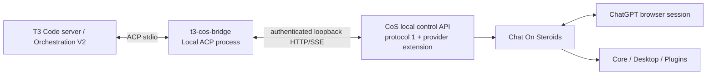

# T3 Code ↔ Chat On Steroids Compatibility Plan

Status: implementation in progress. The bridge contracts, controller client, lazy-binding runtime, recovery guards, offline performance guard tests and release diagnostics exist, but v1 is **not yet release-complete**. The authoritative path to a finished v1 is the "Remaining work to finished v1" section below.

## Current implementation checkpoint

As of the current repository state:

- **Complete in this repository:** project/tooling foundation, compatibility metadata, typed protocol-1 CoS client, provider-extension client contract, prompt normalization, lazy session binding, per-prompt readiness/policy checks, cancellation-intent state-machine handling, single-controller admission leasing semantics, bounded retry/backpressure helpers, release diagnostics, and offline/package-smoke tests.
- **Partially complete:** ACP runtime semantics exist as library code, but there is no production stdio ACP agent entrypoint yet; persistence and admission leasing are currently memory implementations rather than durable/cross-process production implementations; Phase-1 stream/JSON hardening still has known cleanup items.
- **Not yet implemented here:** the actual CoS provider extension described in Phase 2, the Phase-4 event translator/terminal-state machine, durable state/lease storage, production ACP stdio wiring, and the complete pinned live end-to-end acceptance matrix.
- **Previously proven externally:** a disposable Local ACP spike on the pinned running T3 build exercised initialize/new/prompt/stream/Stop, and the exact pinned stock CoS protocol-1 controller suite passed 136/136 targeted tests.
- **Release status:** pre-v1. Do not describe the provider as compatible/release-qualified until the remaining v1 gates below are complete.

## Objective

Make Chat On Steroids (CoS) usable as a first-class coding provider inside T3 Code while preserving the behavior and authority boundaries of both products.

The first product direction is **T3 → CoS**: a T3 thread uses a Local ACP provider process, which drives one CoS prime session/chat through CoS's authenticated local control API. CoS remains the owner of ChatGPT/browser interaction, tool permissions, durable chat/session history, delivery proof, workers, and Stop semantics. T3 remains the owner of its project/thread/run state, UI, provider orchestration, checkpoints, and remote-client authorization.

CoS → T3 through T3's outside-agent MCP surface is a later independent capability and should not be coupled to the provider implementation.

## Pinned development baseline

- T3 running desktop/server: `0.0.46-nightly.20261013.3040`, source SHA `ffb4af8d5d4fcfc5e9322295ff846a6d1e7ffbf8`.
- CoS base for development: `2.1.39`, source SHA `87ae9d631f82d8da2f462d910410031ad8f97ac5`, local control API protocol `1`. The usable v1 compatibility tuple is **base SHA + exact provider-extension commit/build + advertised extension feature versions**. Production either requires an upstream CoS release containing those features or an explicitly supported fork/build with equivalent provenance; stock `2.1.39` alone remains sufficient only for the control-protocol spike.
- ACP TypeScript SDK: pin `@agentclientprotocol/sdk` **1.9.0** exactly for the first implementation lane. Any upgrade is a separate compatibility change with rerun conformance.
- Windows x64 is the first validated platform.

The PATH `t3` CLI is older (`0.0.46-nightly.20261010.2948`) than the running desktop/server. It must not be used for stateful test setup unless its version matches the target server/data store. Automated conformance fixtures should either launch an exact pinned T3 build or interact through the target server/UI.

## Product scope for v1

V1 supports one CoS-backed prime conversation per T3 provider thread with:

- new and multi-turn prompts;
- assistant text in the T3 timeline;
- recorded action activity available through the CoS controller projection (Core tool summaries/file changes plus page/browser/agent activity where recorded);
- exact **CoS project-root** binding;
- deterministic send/idempotency semantics;
- real Stop/cancel behavior;
- provider restart and T3 reconnect/resume;
- honest browser/CoS recovery and provider-error states;
- fixed, explicit provider capabilities;
- same-host, **same OS user/profile** T3 environment/server and CoS desktop app.

V1 does **not** advertise arbitrary T3 worktree cwd support, T3-native model switching, reasoning-effort switching, pre-effect T3 approval/question handling, native subagent semantics, checkpoint rollback/fork, dynamic runtime-mode permission downgrades, remote T3-client control, or multiple simultaneous turns. Browser, Desktop, Core and plugins remain governed by the user's CoS configuration. **CoS workers, Goal/Loop and other background continuations are disabled for bridge-created provider sessions in v1 by an enforced controller/session policy**, because T3 cannot safely settle a provider turn while CoS child work may continue mutating afterward. Two-to-four concurrent chats are a separate desired post-v1 capability with their own qualification gates.

V1 accepts ACP baseline **text + `ResourceLink`** prompt content. It does not advertise image/audio/embedded-resource prompt capabilities. Resource links are accepted only for local `file:` URIs that canonicalize inside the exact bound CoS project root; T3 file/image/captured-window attachment forms that arrive through its current text/image augmentation path are rejected rather than silently reduced to paths the CoS session may not be authorized to read.

## Architecture



The standalone bridge is a TypeScript/Node program. It depends on the public ACP SDK and a project-owned typed CoS-controller client. It does not import T3's private monorepo provider packages.

The bridge is intentionally thin. It owns only:

1. ACP protocol handling and truthful capability advertisement.
2. Binding T3/ACP session identity to a CoS session id.
3. Idempotency/input ids and a small operation journal.
4. CoS endpoint/token discovery and protocol negotiation.
5. CoS SSE cursor/reconnect handling.
6. Translation from authoritative CoS events into ACP updates/terminal results.
7. A truthful ACP protocol-capability policy and version compatibility checks.

It does not duplicate CoS's transcript, outbox, permissions, or browser state.

## Required CoS controller extension

Protocol 1 is retained as the control foundation. Three demonstrated production gaps justify a small backwards-compatible extension in CoS:

### Full-length assistant content

Protocol 1 deliberately caps projected message text at 4,000 characters and tool arguments/results at 2,000 characters. Those caps are good for a diagnostic/control API but make long assistant responses lossy in T3.

Add a provider-oriented authenticated content mechanism that preserves the existing safe projection API. Preferred shape:

- keep protocol-1 event rows and sequence ids unchanged;
- let a truncated **assistant-message** event expose an opaque content reference or stable `(sessionId, seq, field)` locator;
- add a bounded chunk/read endpoint for the complete, controller-safe assistant text;
- support ranged/chunked retrieval with explicit total length and completion marker;
- apply the controller's existing credential-redaction policy before returning content, while removing only the length truncation;
- retain authentication, Host/Origin checks, body/rate limits and request deadlines;
- do not expose secret-bearing fields that protocol 1 intentionally omits;
- make the route discoverable through `/v1/health` capability/route negotiation.

The bridge can then emit complete-length, controller-redacted ACP/T3 assistant content while still using the compact SSE row for ordering and metadata. V1 continues using protocol-1 tool summaries/change metadata and does **not** expose raw full tool arguments/results through the new route.

### Project discovery by canonical path

T3 passes the exact thread/project `cwd` to the ACP process. CoS new-chat creation accepts a `projectId`, but protocol 1 exposes no project catalog/path mapping.

Add a narrow authenticated resolver rather than exposing the whole project catalog, ideally:

```text
POST /v1/projects/resolve
{ "path": "<absolute T3 cwd>" }
→ { "projectId": "...", "name": "..." }
```

Requirements:

- the lookup is read-only in effect and does not require `Allow actions`; it only needs the authenticated control API;
- it resolves the supplied path through CoS's existing approved-root/canonical-path owner, then matches CoS's existing project catalog;
- only projects still valid under CoS approved roots can match;
- no ChatGPT project ids, internal request ids, tokens, or configuration secrets are exposed;
- paths are compared with platform-native canonical identity rules;
- the bridge accepts only an **exact canonical project-root match** for v1 and refuses a T3 cwd with zero or multiple matches instead of guessing;
- no-project mode is deferred. `project_unmapped` never falls back to an unbound chat in v1.

CoS currently derives a durable prime workspace from `SessionSummary.projectId`; an arbitrary T3 worktree path is not a durable CoS session workspace. V1 therefore fails clearly when T3's cwd is a worktree/different checkout rather than silently binding the parent project. A later CoS workspace-binding extension can add an explicitly validated session workspace independent of ChatGPT Project grouping.

### Provider-session background-work policy

CoS workers, Goal/Loop and related continuations can outlive the prime answer. T3 cannot report a provider turn complete while causal background work may still mutate the workspace or re-enter the chat. Add a provider-session policy that is selected atomically when the controller creates the bridge-owned CoS session:

- `backgroundWork=disabled` is immutable for that recorded provider session in v1;
- CoS's worker/orchestration owners refuse worker spawn, Goal/Loop start and equivalent continuation entry points for that session, including after compaction/handoff;
- safe session/live status exposes only the policy attestation needed by the bridge;
- the policy survives CoS restart and session migration;
- protocol-1 clients that do not request provider-session policy retain their existing behavior.

These three additions are enough to make the planned root-checkout v1 transcript/workspace/lifecycle behavior high quality. Model/reasoning selection, external approval routing, arbitrary worktree binding and native background/subagent projection are separate follow-up extensions rather than expanding the first controller patch further.

## Session and identity model

One T3 provider thread maps to one durable bridge ACP session, which maps to one CoS recorded session.

### Lazy CoS chat creation

ACP `session/new` must not create a CoS browser chat. Live testing proved T3 runs disposable provider validation probes and can call `session/new` outside a real project thread. Creating browser chats at ACP session allocation would leak setup probes into the user's history.

Use a lowercase UUID as the ACP/bridge session id. On the first real prompt, reuse that **same UUID** as the first CoS input id; because CoS names a newly created session by its first input id, the durable identities become equal once creation succeeds. This removes an unnecessary session-id mapping layer.

The lifecycle is:

1. `session/new`: allocate the UUID and keep unbound cwd/MCP metadata in memory only; return immediately. Provider-validation probes leave no durable bridge state and create no CoS chat.
2. First real `session/prompt`: resolve the exact CoS project root. Atomically persist `{ sessionId, state:create_pending, activeInputId:sessionId, ... }` **before** the POST.
3. POST `/v1/inputs` without `sessionId`, using the bridge session UUID as `id`; that UUID becomes the CoS session id if admitted.
4. Reconcile delivery/session existence and atomically advance the journal to `bound` only after authoritative evidence. A lost HTTP response does not allocate another first id.
5. Before every subsequent prompt, re-run the exact canonical path resolver and require the current `cwd` to resolve to the same `cosProjectId` and canonical root. If the root disappeared, changed reparse/junction identity, or remapped to another project, fail closed before any send.
6. Subsequent prompts POST with the bound `sessionId` and a fresh stable input UUID.

### Restart/resume

The bridge should advertise ACP `session/resume` once implemented. T3's exact adapter can eagerly resume a persisted native session without creating a new one. For bound sessions, the ACP session id is already the CoS session id; the bridge needs only lifecycle/cursor reconciliation rather than an opaque id translation.

Resume is workspace-strict. Canonicalize the `cwd` supplied by `session/resume` and require it to equal the session's persisted canonical project root. For an unbound session, resolve that exact root before the first prompt. V1 does not support ACP `additionalDirectories`; reject a nonempty set explicitly rather than silently widening workspace semantics.

`session/load` is deferred. Loading requires replaying prior conversation history to the ACP client, while T3 already has its own durable projection and CoS owns its transcript. Resume-without-replay is the smaller and safer v1 contract.

If `session/resume` names an ACP session that never received a real prompt, no CoS session should exist; resume remains unbound and creates nothing until a prompt arrives. If a `create_pending` record exists after a crash, first reconcile `/v1/inputs`, `/v1/sessions/{sessionId}` and session events. Never choose a new first UUID unless CoS proves the prior operation never executed. If a bound session cannot be reconciled after restart, return a visible broken/recovery-required state rather than silently creating a replacement CoS chat.

### Operation journal

Persist only compact records such as:

```text
sessionId                 # ACP id; also CoS session id once bound
bindingState              # unbound | create_pending | bound | broken
canonicalCwd
cosProjectId|null
lastSseSeq
generation
activeInputId|null
activeCosTurnId|null
interactionMode            # default | plan; portable bridge policy restored across ACP child restart
cancelIntent              # none | requested
cancelTargetTurnId|null
lastTerminalOutcome
```

Never persist the CoS bearer token, complete prompts, tool bodies/results, browser data, or duplicated transcript. Journal writes are atomic (temp + fsync/rename or an embedded transactional store) and crash tests cover every mutation boundary.

## Prompt/send state machine

Every user prompt gets a bridge-generated lowercase UUID used as the CoS input id. The journal records it before the POST.

Admission outcomes:

- `202`/new row: accepted into CoS outbox, then follow `/v1/inputs` and session events for delivery truth.
- replay response: same operation already exists; never resend.
- `delivery: sent`: treat as delivered exactly once.
- `delivery: not_sent`: terminal non-delivery; retry only under a new T3 attempt/policy.
- `delivery: unconfirmed`: do not resend automatically. Reconcile through session events/session state and surface ambiguity if it cannot be resolved.
- action timeout before execution: safe retry only when CoS explicitly proves it never started.
- action timeout after execution began: query authoritative state before any retry.

For a first message whose response is lost, its input UUID is also the deterministic CoS session id, so the bridge can query that session directly before deciding what happened.

## Event translation

Run one CoS SSE stream only while a provider thread is active or needs short-term reconciliation. Resume with `Last-Event-ID`/`from` after disconnect; close promptly after terminal settlement.

Translate only authoritative event types:

- `turn_start` → provider turn working/start state as appropriate;
- `assistant_message` revisions/finals → ACP assistant message updates. While a response is under the compact limit, stream revisions normally. Once a revision is truncated, stop repeatedly downloading growing full bodies; keep the compact live projection and fetch the latest full credential-redacted assistant content once at its authoritative final/`turn_end` boundary. If a later extension supports immutable ranged revision deltas, adopt it only with explicit prefix/rewrite verification.
- `tool_call` → completed tool-call/result/item summary; do not synthesize a tool-start event that CoS did not record;
- `page_tool` → visible non-approval browser/page activity with the recorded label only;
- `agent_message` → visible non-approval agent/worker communication activity where the session records it;
- `chat_error` → structured provider/recoverable error mapping;
- `turn_end` → authoritative completion of the prime CoS turn, but ACP terminal success is emitted only when the session also attests the v1 provider policy `backgroundWork=disabled`; if that policy cannot be proven, fail/recover rather than releasing the T3 turn or admission lease;
- `handoff` and live compaction job state → continuity/migration metadata; keep the same CoS session binding;
- `user_message` → delivery/reconciliation evidence, not a second T3 user message when it corresponds to the prompt T3 already recorded.

Tool calls and other action-bearing events are initially rendered as observed activity, not as T3-native approval-capable invocations. Because CoS may have Desktop/browser/plugins enabled, every action-bearing event protocol 1 actually records should be surfaced rather than hidden merely because T3 does not control its approval. Where CoS has ambient authority but protocol 1 exposes no corresponding per-action event, v1 documents that visibility limitation and does not claim complete action auditing. V1's provider-session policy prevents workers/Goal/Loop/background continuations from outliving the prime turn; native background/subagent semantics are a later capability with their own lifecycle contract. A future pre-effect CoS controller request stream can enable T3-native approvals without falsifying history.

## Cancellation

Cancellation is a two-stage state machine.

If the current input is still provably pending, durably record cancellation intent before calling `/v1/inputs/{id}/cancel`. If it has been delivered and a CoS turn is active, first atomically persist `{ cancelIntent: requested, cancelTargetTurnId: activeTurnId }`, then call `/v1/sessions/{id}/stop` with that exact id.

The 202 Stop reply means “requested,” not “finished.” The bridge waits for the matching `turn_end` or a bounded failure/recovery result before returning the ACP prompt terminal state. A stale Stop that receives `turn_not_running` triggers reconciliation and must never be redirected to a newer turn. After a bridge crash/restart, a persisted cancellation intent is reconciled before any new prompt is admitted: retry/recover only against the same saved input/turn identity, or clear the intent after authoritative proof that it already terminated.

After cancellation:

- increment/revoke the bridge generation for the cancelled T3 turn;
- discard late events from completing that T3 run;
- preserve events that describe side effects already committed by CoS/tools;
- do not claim file/process/browser side effects were undone;
- remain reusable only when CoS session/live state proves the session is safe for a next prompt.

## Permissions and capabilities

CoS remains the final authority for host actions. T3 runtime mode cannot grant anything CoS has not enabled.

Protocol 1 has no per-session capability switch and `/v1/status` does not prove the full effective CoS tool-permission set. V1 therefore makes **no claim that T3 permission modes govern CoS tools**. The provider advertises only its protocol/lifecycle capabilities; actual host-tool authority remains the user's current CoS configuration.

V1 is same-user/local-control only. Setup explicitly tells the user that a T3 prompt can cause whatever CoS tools that CoS instance currently permits, including Desktop/browser/plugins. Operators who want a Core-only ceiling must configure CoS itself accordingly. Remote T3 clients are deferred until CoS has an enforceable per-provider/session policy or equivalent capability profile; a documentation convention is not enough.

Static ACP capability advertisement is separate from live readiness. Before every prompt and after any controller restart, re-check CoS health, expected routes/features and `actions.enabled`. A cached startup check is never treated as continuing permission.

Core filesystem root checks and command authority remain distinct: CoS `exec_command` runs with the logged-in user's OS privileges and is not sandboxed to approved roots. Documentation and tests must not imply that an approved project root is a command sandbox.

## T3 MCP injection

Live ACP testing proved T3 injects one thread-scoped `t3-code` MCP server into real Local ACP sessions. V1 does not automatically forward that MCP server into ChatGPT/CoS because CoS already owns its MCP surfaces and recursive routing could duplicate capabilities or alter permission semantics.

The bridge accepts the ACP `mcpServers` field for protocol compliance but does not claim T3 MCP tools are available inside the CoS model until a deliberate, namespaced forwarding design is implemented and tested.

## T3 prompt normalization boundary

The pinned T3 ACP adapter does not send the raw user text unchanged. The live probe and exact source both show:

- the first prompt, and later interaction-mode changes, can wrap the request in `<t3_code_instructions> ... <user_request> ... </user_request>` containing T3 collaborative-browser/orchestration guidance whenever the injected `t3-code` MCP server exists;
- every prompt receives a separate T3-owned `runtime_info` / `pull_request_linking` text block;
- ordinary subsequent prompts are otherwise raw user text;
- leading native slash commands deliberately bypass the wrapper;
- attachment paths/captured-window context can be appended to the user text before wrapping.

Forwarding those blocks verbatim would be incorrect because v1 deliberately does not forward T3 MCP into CoS. The bridge therefore has an explicit **SHA-pinned prompt normalizer** before any journaling or CoS send:

1. Preserve ACP content-block boundaries; never flatten the prompt before classification.
2. Match only the exact T3-owned wrapper/runtime forms recorded for the supported T3 SHA. Extract the user request from the known outer envelope and discard T3 collaborative-browser/orchestration, harness/runtime and PR-linking text that refers to unavailable T3 tools.
3. Preserve portable interaction intent: a recognized T3 `plan` transition updates durable `interactionMode=plan`; `default` updates it back to `default`. Apply a short bridge-owned CoS instruction to investigate read-only and return a plan on **every** prompt while durable state is `plan`, including a raw subsequent prompt after an ACP child restart. This is behavioral guidance, not host permission enforcement. Commit the mode change at the accepted-turn boundary so crash/retry cannot leave an uncorrelated mode transition.
4. Reject an unknown/changed T3 wrapper, unexpected extra T3-owned block, or ambiguous envelope with nonretryable `t3_prompt_contract_mismatch`; never guess and forward it.
5. Do not advertise ACP native slash commands in v1. A leading slash-command prompt is rejected as `unsupported_command` unless a command has an explicit bridge mapping in a later release.
6. Support ACP baseline `ResourceLink` without broadening host authority. Accept only local `file:` URIs whose decoded absolute path canonicalizes inside the session's exact bound project root under the same reparse/junction rules used by project binding. Reject network/remote schemes, UNC/authority-bearing file URIs, outside-root links, ambiguous decoding and links whose canonical identity changes. Do not pre-read the resource into bridge state; append a deterministic, escaped reference line to the CoS text so CoS can open the validated path through its own tools.
7. Do not advertise image/audio/embedded-resource prompt capabilities. Reject pinned-format T3 attachment/captured-window prompt augmentation in v1 instead of forwarding host paths or unbridged binary content.
8. After normalization and safe `ResourceLink` expansion, measure the exact string that will be sent to CoS. Protocol 1 accepts at most **64,000 JavaScript string characters**; reject larger input before the operation journal or controller POST with nonretryable `input_too_large`. Never truncate a user request.

The normalizer is intentionally a version-coupled seam. Compatibility fixtures for each supported T3 SHA cover first prompt, ordinary subsequent prompt, default↔plan transitions, slash-command input, file attachment, image/captured-window attachment, and runtime-instruction blocks. A T3 upgrade is blocked until those fixtures are recaptured/revalidated. The preferred long-term simplification is an upstream T3 Local-ACP option that suppresses T3 MCP/runtime prompt injection for providers that do not consume it; when such an option exists and is proven, use it instead of parsing wrappers.

## Performance design

CoS protocol 1 imposes real controller limits:

- 4 concurrent SSE event streams globally;
- 2 heavy journal reads concurrently;
- actions serialized globally, at most 4 pending;
- 30 actions/minute;
- 600 reads/minute;
- SSE streams expire after 30 minutes and can close on slow consumers.

V1 therefore starts conservatively with an explicit **global admission ceiling of one active T3→CoS turn per stable CoS profile/controller identity**. Because T3 may spawn separate ACP processes for separate threads, this ceiling must be coordinated across processes rather than assumed from one bridge process. The identity key is derived from a stable same-user CoS profile/control-api directory (or later explicit controller instance id), never the ephemeral host:port, process id, or bearer token.

Use a small same-user admission lease in the bridge state directory, namespaced by that stable CoS profile/controller identity. Acquisition is atomic and happens **before any CoS send POST**. The lease contains only nonsecret owner metadata such as `{ sessionId, inputId, turnId?, generation, pid, processStart, heartbeat }`. A second concurrent T3 thread gets a deterministic retryable `input_busy` result; v1 does not silently queue it. PID death, heartbeat expiry, controller port change, token rotation, or CoS process restart alone never releases the lease: a contender must reconcile the saved CoS session/input/turn and any persisted cancellation intent before reclaiming it, because the CoS turn can outlive either process.

V1 behavior:

- one active T3→CoS turn globally for the configured stable CoS profile/controller identity, across endpoint restarts;
- one SSE stream for that active CoS session;
- no polling while SSE is healthy;
- paged reads only for startup/reconciliation/reconnect;
- close SSE immediately after terminal state and retain the cursor;
- coalesce repeated assistant revisions before emitting when T3/UI backpressure requires it, while never coalescing away final content;
- bound all internal queues and reject/backpressure before memory can grow with provider output;
- stream full-content chunks rather than buffering arbitrarily large messages in one allocation;
- keep ACP startup free of CoS HTTP/browser side effects so T3 health probes remain cheap.

**Post-v1 performance expansion** is evidence-driven. After v1 ships, qualify 2–4 simultaneous chats and replace/extend the binary lease with a bounded semaphore only after tests show controller/SSE/browser behavior stays stable. If multi-thread concurrency exceeds the controller's practical stream budget, add a controller multiplexed event stream rather than consuming all four global SSE slots per provider process.

Initial performance gates:

- bridge idle RSS and startup latency measured on Windows;
- first ACP initialize response well below T3 provider-probe timeout;
- no controller request on ACP initialize;
- no CoS chat creation on validation `session/new`;
- two simultaneous T3 threads: the first is admitted, the second is rejected before any CoS POST with retryable `input_busy`, cancelling one never targets the other, and retry succeeds after terminal settlement;
- crash while holding the admission lease does not permit a new send until the old CoS turn is reconciled;
- CoS restart/endpoint-token rotation while the lease is held stays in the same admission domain and cannot admit a second turn before reconciliation;
- constant-memory streaming for large assistant responses;
- bounded event queue under a deliberately slow ACP/T3 consumer;
- reconnect after SSE 30-minute rollover without duplicate transcript rows;
- 4-stream controller cap produces graceful busy/backoff, not spin/poll storms.

## Security and privacy

Same-host/loopback is a deployment choice, not an authentication boundary.

The bridge discovers `endpoint.json` and token from the current user's CoS user-data directory, verifies `/v1/health` protocol/app identity **and required provider-extension feature ids**, and refreshes discovery after connection refusal/restart. It never logs or persists the bearer token.

Controller HTTP inherits CoS protections: loopback Host validation, Origin rejection, bearer token, bounded request bodies, rate limits, serialized actions. The bridge adds:

- exact expected protocol/app-version checks;
- endpoint PID/start-time change detection;
- operation ids and generation checks against stale results;
- structured escaped logs with bridge-generated correlation ids;
- no raw prompt, repository, tool body/result, browser/page or auth-header logging;
- redaction tests including partial credential forms;
- fail-closed handling for unknown controller protocol/schema fields that affect mutation semantics.

The bridge assumes any same-user process that can read the CoS user-data token has equivalent local-account access. It does not claim protection against a compromised same-user account.

## Error model

Use explicit internal categories and map them to the closest ACP/T3 terminal semantics:

- `controller_unavailable` — endpoint absent/refused;
- `controller_auth_changed` — token/process restart; rediscover and reconcile;
- `actions_disabled` — CoS Local control API or Allow actions off;
- `project_unmapped` — T3 cwd has no exact usable CoS project;
- `input_busy` / `queue_full` / `rate_limited` — retryable with bounded backoff;
- `delivery_unconfirmed` — ambiguous, never blind retry;
- `turn_cancel_requested` — Stop admitted, awaiting matching terminal;
- `turn_cancelled` — matching CoS turn ended by cancellation;
- `provider_restriction` / `usage_limit` — surfaced distinctly when CoS records it;
- `browser_recovery` — CoS is still recovering/waiting; not immediate provider failure;
- `session_migrating` — compaction/handoff in progress;
- `session_broken` — binding cannot be safely resumed;
- `provider_policy_unavailable` — required `backgroundWork=disabled` attestation is absent/lost; fail before send or terminal success;
- `unsupported_capability` — explicit refusal rather than approximation;
- `t3_prompt_contract_mismatch` — pinned T3 prompt wrapper/runtime structure changed or cannot be normalized safely;
- `unsupported_command` / `unsupported_prompt_content` — slash command or attachment/content type v1 does not bridge;
- `resource_link_unavailable` — ACP baseline resource link is not a safe local file inside the exact bound project root;
- `input_too_large` — normalized CoS text exceeds the controller's 64,000-character limit; never retry by truncation.

## Development phases

Current phase accounting:

| Phase | Current status |
| --- | --- |
| 0 — foundation | Complete for the current Windows/Node lane. |
| 1 — typed CoS client | Implemented and tested; final malformed-input/SSE/privacy hardening remains in the v1 finish list. |
| 2 — CoS provider extension | Bridge-side typed contract/tests exist; the actual CoS server/build implementation is still required. |
| 3 — ACP shell/lazy binding | Core runtime semantics and offline tests exist; the production stdio ACP process and negotiated lifecycle surface are still required. |
| 4 — event translator | Not yet implemented beyond queue/content-fetch primitives; this is a primary remaining v1 workstream. |
| 5 — lifecycle/recovery | Core fail-closed semantics exist; production durability and true cross-process leasing are still required. |
| 6 — performance | Offline single-turn performance guard tests are implemented; live one-turn latency/browser qualification remains. 2–4 concurrency is post-v1. |
| 7 — E2E/package | Read-only diagnostics and Node+script packaging shape exist; production ACP wiring and the live matrix remain before release. |

### Phase 0 — Project foundation and pinned fixtures

Create the repository/package skeleton, TypeScript config, test runner, lint/typecheck, and small internal modules:

```text
src/acp/
src/cos/
src/session/
src/translate/
src/policy/
src/state/
src/cli/
test/fixtures/
test/integration/
docs/
```

Check in protocol fixtures derived from public/pinned contracts, not copied private transcripts. Record target T3/CoS SHA/version in machine-readable compatibility metadata.

Acceptance:

- clean install/build/test on Windows;
- executable development command uses real `node.exe` + script, never `.cmd` wrapper in T3 config;
- initialize/probe path performs no CoS mutation;
- unit tests run without T3 or CoS installed.

### Phase 1 — Typed CoS controller client

Implement endpoint/token discovery, health negotiation, reads, actions, SSE parser/reconnect, error taxonomy, and idempotent send helpers against protocol 1.

Port the exact semantics exercised by CoS's controller tests into black-box bridge tests, including ambiguous action timeouts and stream end reasons.

Acceptance:

- deterministic schema validation;
- no token logging/persistence;
- reconnect after endpoint/token rotation;
- send replay and ambiguous-delivery tests;
- exact-turn Stop helper waits for matching `turn_end`;
- bounded retry/backoff.

### Phase 2 — CoS controller provider extension

Implement the smallest CoS changes required for production quality before the bridge depends on them:

1. exact canonical project-root resolver;
2. full-length, credential-redacted assistant-content retrieval tied to recorded event identity;
3. an **externally controlled provider-session policy** set atomically when the bridge creates its CoS session, with `backgroundWork=disabled` enforced by the CoS owners for workers, Goal/Loop and equivalent continuations and exposed in safe session/live status;
4. health feature/version discovery for these additions.

Add exact release tests to CoS beside the existing controller suite. Preserve protocol-1 clients and keep raw tool args/results behind the existing bounded projection.

Acceptance:

- all existing protocol-1 controller tests remain green;
- a >4k assistant response can be fetched to full length after the same credential-redaction transform used by the controller;
- raw complete tool args/results remain unavailable in v1;
- exact canonical project-root lookup returns one project id without exposing the whole catalog;
- nonexact worktree/subdirectory paths, unapproved paths and reparse-changed paths fail closed;
- a bridge-created session is born with `backgroundWork=disabled`, attempts to start a worker/Goal/Loop/continuation for that session are refused by CoS, and the policy survives CoS restart/compaction/handoff for the same recorded session;
- safe session/live status lets the bridge verify that background work is disabled without exposing unrelated configuration or secrets;
- `/v1/health` lets the bridge distinguish stock protocol 1 from a build containing the required provider-extension features;
- the extension leaks no additional secret-bearing config fields.

### Phase 3 — ACP shell and lazy binding

Implement initialize, session/new, session/prompt, session/cancel and session/resume.

Capability negotiation is exact. Do not emit a generic ACP v2 `session: {}` capability object unless the bridge implements every baseline method that shape implies (`session/list`, `session/resume`, `session/close`, prompt/cancel/update). If T3 negotiates a protocol variant whose capability shape implies more methods than v1 needs, either implement the small required lifecycle surface with correct semantics or advertise the narrower compatible shape. Every advertised method gets a conformance test.

`session/new` allocates only in-memory bridge state. First prompt resolves the exact CoS project root through the extension, durably records `create_pending`, and lazily creates the CoS session using the ACP session UUID as the CoS first input/session id.

Implement the SHA-pinned prompt normalizer before the send state machine. Normalization and the 64k/content-capability checks happen **before** `create_pending` or any input id is journaled, so a rejected prompt cannot look like an ambiguous controller mutation.

Acceptance through the exact pinned T3 server:

- provider validation creates no CoS chat and leaves no durable probe journal;
- capability negotiation never advertises an unimplemented ACP lifecycle method; negotiated v2 list/resume/close behavior is tested explicitly when that shape is used;
- first/subsequent/default↔plan prompt fixtures recover only the intended portable user request/mode behavior and remove unavailable T3 MCP/runtime instructions;
- plan mode survives an idle ACP child restart: a raw next prompt still receives bridge-owned read-only Plan guidance, and the next recognized default transition clears the durable mode deterministically;
- slash commands and T3 attachment/captured-window prompt forms fail explicitly before any CoS action;
- baseline ACP `ResourceLink` accepts a canonical in-root local file URI and produces only an escaped validated-path reference; non-file, UNC/authority, outside-root, traversal/reparse-changed and ambiguous links fail before journaling/send;
- normalized input at 64,000 characters is accepted by the bridge client contract; 64,001 is rejected as `input_too_large` without journaling or POST;
- real T3 thread starts in exact project-root cwd;
- first prompt creates exactly one CoS session using the same UUID as the ACP session id;
- second prompt reuses it;
- T3 Stop reaches exact CoS Stop and settles cancelled;
- `session/resume` before any first prompt creates no CoS chat;
- process restart after a bound prompt resumes the same CoS session;
- crash before POST, after dispatch/no response and after 202/before `bound` persistence all reconcile without a duplicate first chat/input.

### Phase 4 — Event translator and terminal semantics

Translate CoS recorded events to ACP updates with stable dedupe keys `(session, seq, field/revision)` and a per-turn generation.

Implement turn state, errors, tool summaries, handoffs, terminal outcome mapping, and cursor persistence.

Acceptance:

- multi-turn transcript has no duplicates after SSE reconnect;
- assistant revisions converge to the exact final text;
- long text stays complete;
- tool completion appears once with correct outcome/change metadata;
- prime `turn_end` plus verified `backgroundWork=disabled` is the only normal v1 terminal proof; loss of that policy attestation fails safe instead of settling success;
- compaction/handoff preserves the bridge session binding;
- stale generation events cannot complete a newer T3 turn.

### Phase 5 — Capability truthfulness, lifecycle and recovery hardening

Implement truthful ACP protocol capability advertisement, per-prompt CoS readiness checks, startup/restart reconciliation, crash recovery, cross-process admission leasing, bounded backoff, and explicit unsupported capability handling. Do not present T3 runtime mode as a CoS host-tool permission system.

Acceptance:

- T3 cannot expand CoS authority;
- provider reports CoS action-readiness/permission availability accurately without claiming T3 runtime-mode enforcement;
- provider revalidates the enforced `backgroundWork=disabled` session policy after CoS restart/resume and before every prompt; policy loss marks the session unavailable/broken before any new send;
- every action-bearing CoS event available through the supported controller projection is visible in T3 as non-approval activity, and any known observability gaps are explicit;
- browser/companion disconnect does not create duplicate sends;
- bridge crash at each send/Stop boundary resumes or surfaces ambiguity without re-executing;
- crash after cancellation intent is persisted, before/during the controller cancel/Stop call, preserves the user's cancellation target and reconciles only that exact input/turn after restart;
- CoS restart/token rotation reconnects safely;
- T3 restart resumes the same CoS session;
- resume with a different canonical cwd or nonempty `additionalDirectories` is rejected before any CoS action;
- a bound project root replaced/remapped between turns is detected before send and transitions the session to `project_unmapped`/broken rather than following the new target;
- no cross-thread binding or stale-session mutation.

### Phase 6 — V1 performance qualification

Qualify the supported v1 ceiling of one active bridged turn per stable CoS controller identity. Record controller utilization, stream behavior, memory, latency and browser reliability. The repository already contains deterministic offline tests for bounded queueing, O(final-size) assistant-content retrieval, bounded safe-read retries, queue-full no-spin behavior and one-for-one SSE reconnects.

V1 remains single-turn. **2–4 concurrent CoS chats are a desired post-v1 feature**, not a v1 release gate. If the four-SSE global limit is the binding constraint, add a multiplexed stream/controller extension before advertising higher fanout.

Acceptance:

- bounded memory under large output/slow consumer;
- bytes fetched for a long revision-heavy assistant response stay O(final response size), not O(revision count × response size), while final controller-redacted content remains exact;
- no polling storms;
- no fifth-stream spin when controller returns 503;
- predictable backoff and visible queueing;
- restart/reconnect load remains bounded;
- one-turn latency regression versus direct CoS stays within an agreed measured budget.

### Phase 7 — End-to-end acceptance and packaging

Use a real Windows executable path suitable for T3's `shell:false` Local ACP config. The selected/validated launch shape is the real installed `node.exe` plus the built `dist/cli/index.js` script; `.cmd`/`.bat` wrappers are unsupported. The current CLI is not yet the production ACP provider, so this is not a release-qualification claim. A self-contained bridge executable is optional packaging work, not a correctness requirement. The supported CoS side must be either an upstream CoS release containing the Phase-2 provider extension or an explicitly versioned companion/fork build distributed with clear provenance.

Release diagnostics are implemented read-only. Before release they must also be exercised against the supported live CoS build and confirm the exact base/extension compatibility tuple, controller enabled/actions enabled, compatible routes, exact project resolution, endpoint health, and same-user/profile deployment assumptions. Same-host/different-user service scenarios remain deferred.

Run an end-to-end matrix on the pinned T3/CoS pair:

- simple turn;
- multi-turn;
- long assistant output;
- filesystem edit + tool summary;
- queued/ambiguous send;
- Stop before delivery;
- Stop during active answer/tool activity;
- SSE disconnect/reconnect;
- bridge process restart;
- CoS restart;
- T3 restart;
- CoS Compact & Resume/handoff;
- CoS action-readiness/permission availability change;
- unavailable project;
- rate-limit/usage/provider error;
- slow consumer/backpressure;
- attempted worker/Goal/Loop/background continuation is refused for the provider session and cannot outlive prime `turn_end`;
- no concurrency-above-one scenario is required for v1 because v1 advertises a one-turn ceiling.

Do a current-T3-HEAD drift run separately. Failure there does not invalidate the pinned release, but it produces a compatibility issue before upgrading the support matrix.

## Remaining work to finished v1

The following list supersedes phase-number optimism and is the authoritative remaining implementation/release sequence.

### 1. Finish the production CoS provider extension

Implement and version the Phase-2 server-side functionality in a real CoS source/build, not only the bridge-side typed contract:

- exact canonical project-root resolver;
- ranged full-length assistant-content retrieval using the controller's credential-redaction transform;
- atomically selected and persistently enforced `backgroundWork=disabled` provider-session policy;
- refusal of worker/Goal/Loop/equivalent continuation creation for those sessions;
- safe policy attestation in session/live status;
- health feature/version advertisement and exact regression tests beside the CoS controller suite.

Exit gate: publish or otherwise provenance-pin the exact CoS extension build/commit and pass both the pre-existing controller suite and the new extension tests.

### 2. Finish the actual ACP provider process

Wire the public ACP SDK to a production stdio entrypoint instead of exposing only library/runtime helpers and diagnostics:

- initialize/new/prompt/cancel/resume handlers for the protocol form negotiated by the pinned T3 server;
- implement any baseline v2 lifecycle methods implied by the advertised v2 capability shape (`session/list`, `session/close`, and resume semantics) or advertise a narrower shape that T3 accepts truthfully;
- keep provider validation and `session/new` free of CoS mutations;
- stream ACP updates through the client notification surface;
- map internal bridge errors to stable ACP terminal/error semantics;
- add a true stdio harness test that launches the built script as a child process and speaks ACP over NDJSON.

Exit gate: the built `node.exe + dist/cli/index.js` provider can be selected by pinned T3 and complete a deterministic fake-controller turn without bypassing the production entrypoint.

### 3. Implement Phase-4 event translation and terminal semantics

Build the currently missing translator/state machine:

- consume CoS event sequence/cursors and dedupe `(session, seq, field/revision)`;
- retrieve full assistant content only from authoritative final/revision identities;
- project supported action/tool/file activity without exposing raw secret-bearing bodies;
- persist cursor + generation so reconnect/restart cannot replay stale terminal state;
- map `turn_end`, cancellation, provider/usage errors, browser recovery, compaction/handoff and broken-policy conditions to ACP/T3 outcomes;
- require both exact root-turn terminal evidence and current `backgroundWork=disabled` attestation before normal success.

Exit gate: reconnect, revision-heavy long output, tool summary, cancellation, handoff and stale-generation fixtures all converge exactly once.

### 4. Replace in-memory recovery primitives with durable production state

The current `MemoryStateStore` and `MemoryAdmissionLease` are test/reference implementations. Add a same-user local durable store and a truly cross-process admission mechanism keyed by stable CoS profile/controller identity.

Requirements:

- atomic state writes for binding, cursor/generation, normalized interaction mode and cancellation target;
- crash-safe recovery for `create_pending`, ambiguous delivery and Stop boundaries;
- lease ownership survives ACP child death until authoritative reconciliation proves the old turn is terminal;
- no endpoint/port/PID/token-derived lease identity;
- bounded retention and metadata-only persisted diagnostics.

Exit gate: kill/restart tests at each send/cancel persistence boundary resume or fail safe without duplicates or stale release.

### 5. Finish controller/client hardening and privacy checks

Close the remaining low-level release defects before live acceptance:

- deterministic error wrapping for malformed endpoint JSON, invalid endpoint URLs and malformed JSON responses;
- correct CRLF SSE framing plus bounded reconnect/failure-storm behavior and long-stream rollover coverage;
- ensure low-level `.cause` values cannot leak credentials/config in surfaced diagnostics;
- validate every mutation response enum/schema, not only read-side rows;
- add metadata-only structured logging/redaction tests for hostile identifiers and partial secrets.

Exit gate: all controller/client fuzz/error-path tests are deterministic and content/token safe.

### 6. Resolve the development-toolchain audit before release

Upgrade the development-only test/lint toolchain in a compatibility-isolated change, then rerun all tests/build/package smoke. Do not auto-fix blindly. Record the final `npm audit` state and why any residual advisory is non-runtime or otherwise accepted.

Exit gate: no unresolved critical/high advisory is silently carried into the release record without an explicit documented disposition.

### 7. Run live single-turn performance qualification

Exercise the finished provider on the pinned live CoS/T3 lane with one active bridged turn and record:

- end-to-end turn latency versus direct CoS for the same class of task;
- browser reliability during long output and reconnect/restart cases;
- peak bridge RSS/queue depth under large output and deliberately slow ACP consumption;
- controller request/SSE utilization and reconnect behavior;
- no polling storm or retry spin under queue-full/controller-restart conditions.

Exit gate: the measured one-turn latency budget is explicitly agreed/recorded and all Phase-6 bounded-memory/reconnect/browser gates pass live. This is a v1 gate; 2–4 chat concurrency is not.

### 8. Run the pinned live v1 acceptance matrix

With the user explicitly enabling CoS Local control API and, for mutating tests, Allow actions, run the complete pinned T3 → ACP → CoS matrix listed in Phase 7. Preserve setup-invalid attempts and distinguish software failures from environment/user-action gates.

Required outcomes include zero duplicate sends, zero cross-session actions, complete >4k assistant output, exact cancellation, restart/resume continuity, policy enforcement across restart/compaction/handoff, bounded recovery under disconnects, and truthful CoS action-unavailable/permission/provider error states.

Exit gate: all v1 release criteria below pass on the pinned support tuple and the exact evidence is recorded.

### 9. Drift, packaging record and release cut

- run a separate current-T3-HEAD drift lane and record incompatibilities without changing the pinned support claim;
- verify clean install/build/test/package-smoke from a fresh checkout;
- record exact Node/T3/CoS/extension/ACP-SDK versions and hashes;
- publish final setup/use/troubleshooting documentation;
- tag/cut v1 only after the repository is clean and the pinned live matrix is green.

At that point the project is "finished v1": it is usable, reproducibly packaged, truthfully scoped, and release-qualified on the pinned Windows lane.

## Testing strategy

Use four layers:

1. **Pure unit tests** for schemas, identity, state machines, event translation, dedupe, error mapping and policy.
2. **Controller contract tests** against a deterministic fake plus copied behavioral cases from the public CoS contract; run the actual CoS controller suite when developing its extension.
3. **ACP harness tests** using stdio and the public SDK for initialize/new/prompt/cancel/resume behavior.
4. **Real integration tests** against explicitly pinned T3/CoS builds for the behaviors that depend on their processes/browser.

Do not write implementation-mirroring tests for trivial helpers. Focus on delivery ambiguity, stale identity, cancellation races, crash boundaries, full-content correctness and permission failures.

## Observability

Default logs are metadata-only:

```text
timestamp
level
bridge correlation id
ACP session id hash/short id
CoS session id hash/short id
operation kind
state transition
HTTP status / protocol error category
latency / byte counts / queue depth
```

No prompt text, assistant text, tool args/results, paths beyond an explicitly safe normalized project label, browser text, token, auth headers, raw config, or plugin payloads.

Debug protocol tracing must be explicit, bounded and redacted; it should still avoid content bodies by default.

## Feasibility review

The design is feasible. The live spike proved the T3 Local ACP seam on the actual running V2 server, including project cwd, T3 MCP injection, streaming output and cancellation. CoS's pinned controller tests prove the other side has robust idempotency, SSE and Stop semantics. No native T3 provider fork is needed for the scoped v1.

The required CoS additions are narrow and align with owners already present in CoS: the project subsystem already owns canonical project records/path validation, session recording already owns full assistant message content, and session/orchestration owners already decide whether workers/Goal/Loop may run. The extension resolves an exact path through those owners, exposes full-length credential-redacted assistant text, and adds an enforceable provider-session `backgroundWork=disabled` policy without creating a second state store or widening raw tool-body exposure.

The main feasibility risk is product authority, not transport: CoS ultimately drives a ChatGPT browser session and its host-tool permissions are app-owned rather than dynamically narrowed by T3. V1 therefore advertises only the ACP protocol/lifecycle capabilities it implements, rechecks live controller/action readiness at prompt boundaries, makes no T3 tool-permission claim, and is same-user/local-control only. The current CoS configuration remains authoritative for Core/Desktop/browser/plugin power; remote T3 control waits for an enforceable CoS per-provider/session policy.

## Quality review

The plan rejects two tempting low-quality shortcuts:

- shipping T3 with truncated protocol-1 transcript content;
- keeping a manual bridge database that maps T3 folder paths to opaque CoS project UUIDs.

Both would work in demos but create user-visible correctness and maintenance problems. The small controller extension keeps project/transcript truth with CoS and lets the bridge remain stateless enough to recover safely.

The plan also keeps unsupported T3 capabilities false instead of approximating them. That makes the first release narrower but avoids false approvals, fake model selection, unsafe rollback semantics and confusing background-worker behavior.

## Performance review

The architecture avoids a polling-heavy bridge: active turns use one SSE stream, idle threads keep only a cursor, and controller reads are for setup/recovery. This matches CoS's bounded controller design and keeps T3 UI traffic independent of CoS's full transcript size.

The principal performance constraint is the controller's four-stream global cap. A one-active-turn initial ceiling is intentionally conservative. It prevents hidden contention with other local controller clients and avoids making browser automation concurrency a release assumption. The plan includes a measured qualification phase before increasing it.

Full-content retrieval must be chunked/streamed to avoid turning the bridge into a duplicate transcript buffer. The bridge should have fixed queue and message-chunk limits, and backpressure should delay/coalesce nonterminal UI updates rather than drop authoritative terminal/content state.

## Maintenance review

The maintenance boundary is intentionally stable:

- public ACP SDK on the T3 side;
- versioned, discoverable CoS controller API on the other;
- exact pinned black-box compatibility lanes;
- no imports from T3 private workspace packages;
- no browser DOM scraping in the bridge;
- no duplicate CoS state store.

The one deliberately version-coupled exception is T3 prompt normalization. It is guarded by exact-SHA fixtures and fail-closed matching because current T3 ACP injects T3-only instructions into the prompt while the v1 bridge does not expose the corresponding MCP tools. Prefer removing this seam through an upstream T3 "raw/portable prompt context" option once available; do not loosen matching to accommodate drift.

When T3 changes internally, most drift is absorbed by its ACP adapter. When CoS changes browser internals, its controller/session owners absorb that drift. The bridge changes only when ACP or the controller contract changes.

## Release criteria for “compatible”

Do not call the provider compatible until all of the following are true on the pinned support pair:

- adding/validating the provider creates no stray CoS chats;
- an exact canonical T3 project-root cwd maps to the intended CoS project without guessing, while worktree/subdirectory cwd fails clearly as unsupported;
- every admitted user prompt is delivered at most once;
- T3-owned MCP/runtime wrapper text is never forwarded as if authored by the user, plan-mode intent is preserved, and unknown wrapper drift fails closed;
- unsupported attachments/slash commands, unsafe resource links and >64k normalized prompts fail before journaling/send, while an in-root ACP baseline `ResourceLink` is handled without reading/copying its contents into bridge state;
- ambiguous delivery never triggers an automatic duplicate;
- assistant content shown in T3 is complete, including responses over 4,000 characters;
- bridge-created CoS sessions enforce `backgroundWork=disabled`; no worker/Goal/Loop/continuation can outlive prime `turn_end`, and loss of that attestation never settles success;
- cancellation targets only the exact active CoS turn and reaches a bounded terminal state;
- late/stale events cannot complete a newer T3 run;
- provider/T3/CoS restart resumes the same intended session or visibly fails safe;
- T3 cannot widen CoS host authority;
- unsupported capabilities are absent from the provider contract/UI;
- controller credentials and chat/tool contents do not appear in bridge logs/state;
- memory, queue depth and reconnect behavior remain bounded under large output and slow consumers;
- the end-to-end acceptance matrix passes with zero duplicate sends and zero cross-thread/session actions.

## Post-v1 roadmap

After v1 is stable, pursue these in this order unless product priorities change:

1. **2–4 concurrent CoS chats/threads.** This is a desired feature immediately after v1, not merely an exploratory idea. Qualify two concurrent chats first, then four. Replace the v1 single-slot admission lease with a bounded profile-wide scheduler while retaining one active root turn per bound session. Measure browser reliability, queue depth, memory, controller utilization, latency, cancellation isolation and stale-event isolation. Respect the controller's four-SSE global cap; if four bridged chats cannot coexist safely with controller overhead/other clients, add a multiplexed event-stream extension before advertising the higher ceiling. Concurrency must be capability-advertised from measured support rather than configured optimistically.
2. model/reasoning selection bound to an exact CoS input;
3. pre-effect external approval/question routing so T3 can own those interactions;
4. deliberate T3 MCP forwarding/namespacing into CoS;
5. CoS worker/subagent projection into T3 native subagent UI;
6. ACP v2-only features where they add concrete value;
7. macOS/Linux packaging and conformance;
8. CoS→T3 outside-agent MCP packaging;
9. optional legacy T3 `v0.0.42` lane;
10. native T3 provider only if a measured ACP limitation cannot be solved at the CoS/controller layer.
