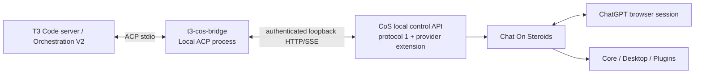

# T3 Code ↔ Chat On Steroids Compatibility Plan

Status: **v1.0.0 release-qualified** on the pinned Windows support tuple. The implementation, live acceptance, performance, current-T3 drift, fresh-checkout release preparation, and final release manifest are complete for V1; the remaining sections below are retained as the design/qualification specification and historical implementation plan.

## Current implementation checkpoint

As of the qualified `v1.0.0` repository state:

- **Complete in this repository:** project/tooling foundation, pinned compatibility metadata, typed protocol-1 CoS client, all five required provider-extension contracts including `provider-turn-drain-v1` and `provider-turn-recovery-v1`, prompt normalization, lazy session binding, per-prompt readiness/policy checks, exact cancellation/restart recovery, durable cross-process session/admission state, bounded streaming/backpressure, the production ACP stdio entrypoint, event translation/terminal settlement, privacy-safe diagnostics/metrics, and release-readiness derivation.
- **Qualified live behavior:** Step 7 performance/reconnect/restart/slow-consumer lanes are PASS, and the complete pinned V1-01…V1-19 acceptance matrix is PASS on the final bridge/provider tuple. The preserved historical broken V1-11 admission domain remains untouched fail-closed regression evidence; qualification uses a separate fresh final-tuple V1-11 PASS.
- **Release preparation:** current upstream T3 HEAD drift is recorded separately as compatible without widening the pinned support claim, and fresh-checkout verification, audit, launcher proof, evidence closure, and final manifest promotion are complete.
- **Release status:** `v1.0.0` is tagged and release-qualified for the explicit pinned tuple and support boundaries documented in `docs/release-status.md` and `docs/evidence/v1-09-release.md`. Post-v1 items such as 2–4 concurrent bridged chats remain outside the V1 support claim.

## Objective

Make Chat On Steroids (CoS) usable as a first-class coding provider inside T3 Code while preserving the behavior and authority boundaries of both products.

The first product direction is **T3 → CoS**: a T3 thread uses a Local ACP provider process, which drives one CoS prime session/chat through CoS's authenticated local control API. CoS remains the owner of ChatGPT/browser interaction, tool permissions, durable chat/session history, delivery proof, workers, and Stop semantics. T3 remains the owner of its project/thread/run state, UI, provider orchestration, checkpoints, and remote-client authorization.

CoS → T3 through T3's outside-agent MCP surface is a later independent capability and should not be coupled to the provider implementation.

## Pinned development baseline

- T3 running desktop/server: `0.0.46-nightly.20261013.3040`, source SHA `ffb4af8d5d4fcfc5e9322295ff846a6d1e7ffbf8`.
- CoS base for development: `2.1.39`, source SHA `87ae9d631f82d8da2f462d910410031ad8f97ac5`, local control API protocol `1`. The usable v1 compatibility tuple is **base SHA + exact provider-extension commit/build + advertised extension feature versions**. Production either requires an upstream CoS release containing those features or an explicitly supported fork/build with equivalent provenance; stock `2.1.39` alone remains sufficient only for the control-protocol spike.
- ACP TypeScript SDK: pin `@agentclientprotocol/sdk` **1.9.0** exactly for the first implementation lane. Any upgrade is a separate compatibility change with rerun conformance.
- Windows x64 is the first validated platform.

The PATH `t3` CLI is older (`0.0.46-nightly.20261010.2948`) than the running desktop/server. It must not be used for stateful test setup unless its version matches the target server/data store. Automated conformance fixtures should either launch an exact pinned T3 build or interact through the target server/UI.

## Product scope for v1

V1 supports one CoS-backed prime conversation per T3 provider thread with:

- new and multi-turn prompts;
- assistant text in the T3 timeline;
- recorded action activity available through the CoS controller projection (Core tool summaries/file changes plus page/browser/agent activity where recorded);
- exact **CoS project-root** binding;
- deterministic send/idempotency semantics;
- real Stop/cancel behavior;
- provider restart and T3 reconnect/resume;
- honest browser/CoS recovery and provider-error states;
- fixed, explicit provider capabilities;
- same-host, **same OS user/profile** T3 environment/server and CoS desktop app.

V1 does **not** advertise arbitrary T3 worktree cwd support, T3-native model switching, reasoning-effort switching, pre-effect T3 approval/question handling, native subagent semantics, checkpoint rollback/fork, dynamic runtime-mode permission downgrades, remote T3-client control, or multiple simultaneous turns. Browser, Desktop, Core and plugins remain governed by the user's CoS configuration. **CoS workers, Goal/Loop and other background continuations are disabled for bridge-created provider sessions in v1 by an enforced controller/session policy**, because T3 cannot safely settle a provider turn while CoS child work may continue mutating afterward. Two-to-four concurrent chats are a separate desired post-v1 capability with their own qualification gates.

V1 accepts ACP baseline **text + `ResourceLink`** prompt content. It does not advertise image/audio/embedded-resource prompt capabilities. Resource links are accepted only for local `file:` URIs that canonicalize inside the exact bound CoS project root; T3 file/image/captured-window attachment forms that arrive through its current text/image augmentation path are rejected rather than silently reduced to paths the CoS session may not be authorized to read.

## Architecture



The standalone bridge is a TypeScript/Node program. It depends on the public ACP SDK and a project-owned typed CoS-controller client. It does not import T3's private monorepo provider packages.

The bridge is intentionally thin. It owns only:

1. ACP protocol handling and truthful capability advertisement.
2. Binding T3/ACP session identity to a CoS session id.
3. Idempotency/input ids and a small operation journal.
4. CoS endpoint/token discovery and protocol negotiation.
5. CoS SSE cursor/reconnect handling.
6. Translation from authoritative CoS events into ACP updates/terminal results.
7. A truthful ACP protocol-capability policy and version compatibility checks.

It does not duplicate CoS's transcript, outbox, permissions, or browser state.

## Required CoS controller extension

Protocol 1 is retained as the control foundation. Four demonstrated production gaps justify a small backwards-compatible extension in CoS:

### Full-length assistant content

Protocol 1 deliberately caps projected message text at 4,000 characters and tool arguments/results at 2,000 characters. Those caps are good for a diagnostic/control API but make long assistant responses lossy in T3.

Add a provider-oriented authenticated content mechanism that preserves the existing safe projection API. Preferred shape:

- keep protocol-1 event rows and sequence ids unchanged;
- let a truncated **assistant-message** event expose an opaque content reference or stable `(sessionId, seq, field)` locator;
- add a bounded chunk/read endpoint for the complete, controller-safe assistant text;
- support ranged/chunked retrieval with explicit total length and completion marker. **Range units are UTF-16 code units**, matching JavaScript string indexing/`.length`. `offset`, `limit` and `totalLength` all use those units. Require `limit >= 2`; valid responses never split a UTF-16 surrogate pair at either boundary, may return fewer than `limit` code units to preserve a pair, and reject a requested `offset` that lands inside a surrogate pair. The bridge advances by the returned `text.length`, not by UTF-8 byte count or Unicode code-point count;
- apply the controller's existing credential-redaction policy before returning content, while removing only the length truncation;
- retain authentication, Host/Origin checks, body/rate limits and request deadlines;
- do not expose secret-bearing fields that protocol 1 intentionally omits;
- make the route discoverable through `/v1/health` capability/route negotiation.

The bridge can then emit complete-length, controller-redacted ACP/T3 assistant content while still using the compact SSE row for ordering and metadata. V1 continues using protocol-1 tool summaries/change metadata and does **not** expose raw full tool arguments/results through the new route.

### Project discovery by canonical path

T3 passes the exact thread/project `cwd` to the ACP process. CoS new-chat creation accepts a `projectId`, but protocol 1 exposes no project catalog/path mapping.

Add a narrow authenticated resolver rather than exposing the whole project catalog, ideally:

```text
POST /v1/projects/resolve
{ "path": "<absolute T3 cwd>" }
→ { "projectId": "...", "name": "..." }
```

Requirements:

- the lookup is read-only in effect and does not require `Allow actions`; it only needs the authenticated control API;
- it resolves the supplied path through CoS's existing approved-root/canonical-path owner, then matches CoS's existing project catalog;
- only projects still valid under CoS approved roots can match;
- no ChatGPT project ids, internal request ids, tokens, or configuration secrets are exposed;
- paths are compared with platform-native canonical identity rules;
- the bridge accepts only an **exact canonical project-root match** for v1 and refuses a T3 cwd with zero or multiple matches instead of guessing;
- no-project mode is deferred. `project_unmapped` never falls back to an unbound chat in v1.

CoS currently derives a durable prime workspace from `SessionSummary.projectId`; an arbitrary T3 worktree path is not a durable CoS session workspace. V1 therefore fails clearly when T3's cwd is a worktree/different checkout rather than silently binding the parent project. A later CoS workspace-binding extension can add an explicitly validated session workspace independent of ChatGPT Project grouping.

### Provider-session background-work policy

CoS workers, Goal/Loop and related continuations can outlive the prime answer. T3 cannot report a provider turn complete while causal background work may still mutate the workspace or re-enter the chat. Add a provider-session policy that is selected atomically when the controller creates the bridge-owned CoS session:

- `backgroundWork=disabled` is immutable for that recorded provider session in v1;
- CoS's worker/orchestration owners refuse worker spawn, Goal/Loop start and equivalent continuation entry points for that session, including after compaction/handoff;
- safe session/live status exposes only the policy attestation needed by the bridge;
- the policy survives CoS restart and session migration;
- protocol-1 clients that do not request provider-session policy retain their existing behavior.

### Authoritative provider-turn drain/high-water

Exact CoS `v2.1.39` completion-order tests prove that request-owned tool activity may be recorded **after** a native assistant final/`turn_end`, even though it still belongs to that older turn. Exact pinned T3 `ffb4af8d...` source proves generic Local ACP v1 cannot safely receive those updates after the original `session/prompt` RPC resolves: the adapter has already finalized/cleared that active turn, and a later same-session prompt can steal late session-only updates. Therefore `turn_end` is not sufficient terminal proof for this bridge.

Add a provider-only, append-only terminal drain contract:

- `/v1/health` advertises `provider-turn-drain-v1: 1`;
- a bridge-created provider turn has an exact controller input id + CoS `turnId` ownership record;
- when terminal native evidence is recorded, the target session's serialized store operation first durably moves that provider turn to `closing`, then appends/publishes the externally visible terminal `turn_end`. Thus by the time SSE/read clients can observe `turn_end`, the effect-admission fence is already active. A newly arriving MCP/tool/worker/Goal/Loop/continuation request attributed to the closing/sealed turn is refused before side effect rather than being allowed to start after terminal proof;
- calls already admitted before the closing fence may finish. CoS waits for their running/settling recorder work, request-attribution repair and target-session event-store queue to flush;
- once every already-admitted request-owned row for that turn is durable, CoS appends one durable session event projected by protocol 1 as `{ type:"turn_drained", turnId, inputId, highWaterSeq, finalAssistantSeq }`, where `highWaterSeq` is the marker event's own sequence number and `finalAssistantSeq` is either `null` or the exact sequence number of the single authoritative final assistant-message snapshot for that provider turn after all pre-drain corrections/revisions have landed;
- `finalAssistantSeq`, when nonnull, must reference an `assistant_message` event for the same session/provider turn with `final:true` and `seq <= highWaterSeq`. Any earlier `final:true` snapshot for that turn is historical/non-authoritative and must not be emitted by the v1 bridge. After `turn_drained`, the referenced event identity/full-content result is immutable. If CoS cannot identify one authoritative final snapshot, the turn drains with `finalAssistantSeq:null` and the bridge emits no assistant prose rather than guessing;
- the marker is a contract: no later **new provider-visible/request-owned event** (assistant/final revision, tool/action, page activity, worker/agent activity or error row) may be appended for that `(sessionId, turnId, inputId)`. A late historical DOM/message correction may update internal observational bookkeeping only if it leaves the already-drained provider-facing event/content identity unchanged; it cannot alter final provider content, create new activity, or reopen the sealed provider turn;
- the closing/sealed fence and any committed drain marker survive CoS restart and session compaction/handoff. If CoS restarts while a provider turn is `closing` but has no committed drain marker, it may resume draining **only when durable request/session/outbox evidence can prove every pre-restart admitted effect is already represented or provably never started**. If that proof is unavailable, mark the provider turn/session drain as unrecoverable/broken, refuse new provider input and never synthesize `turn_drained` from silence;
- a quiet-time/silence timer is never terminal proof. If the recorder/admission owners cannot establish the fence above, Step 1 is blocked rather than substituting a debounce.

For active-turn cancellation, the same marker is required after the matching stopped/cancelled `turn_end`; for an input cancelled before any CoS turn exists, authoritative `not_sent`/cancelled input delivery proof remains sufficient because there is no turn to drain.

These four additions are enough to make the planned root-checkout v1 transcript/workspace/lifecycle behavior high quality. Model/reasoning selection, external approval routing, arbitrary worktree binding and native background/subagent projection are separate follow-up extensions rather than expanding the first controller patch further.

## Session and identity model

One T3 provider thread maps to one durable bridge ACP session, which maps to one CoS recorded session.

### Lazy CoS chat creation

ACP `session/new` must not create a CoS browser chat. Live testing proved T3 runs disposable provider validation probes and can call `session/new` outside a real project thread. Creating browser chats at ACP session allocation would leak setup probes into the user's history.

Use a lowercase UUID as the ACP/bridge session id. On the first real prompt, reuse that **same UUID** as the first CoS input id; because CoS names a newly created session by its first input id, the durable identities become equal once creation succeeds. This removes an unnecessary session-id mapping layer.

The lifecycle is:

1. `session/new`: allocate the UUID and keep unbound cwd/MCP metadata in memory only; return immediately. Provider-validation probes leave no durable bridge state and create no CoS chat.
2. First real `session/prompt`: resolve the exact CoS project root. Atomically persist `{ sessionId, state:create_pending, activeInputId:sessionId, ... }` **before** the POST.
3. POST `/v1/inputs` without `sessionId`, using the bridge session UUID as `id`; that UUID becomes the CoS session id if admitted.
4. Reconcile delivery/session existence and atomically advance the journal to `bound` only after authoritative evidence. A lost HTTP response does not allocate another first id.
5. Before every subsequent prompt, re-run the exact canonical path resolver and require the current `cwd` to resolve to the same `cosProjectId` and canonical root. If the root disappeared, changed reparse/junction identity, or remapped to another project, fail closed before any send.
6. Subsequent prompts POST with the bound `sessionId` and a fresh stable input UUID.

### Restart/resume

The bridge should advertise ACP `session/resume` once implemented. T3's exact adapter can eagerly resume a persisted native session without creating a new one. For bound sessions, the ACP session id is already the CoS session id; the bridge needs only lifecycle/cursor reconciliation rather than an opaque id translation.

Resume is workspace-strict. Canonicalize the `cwd` supplied by `session/resume` and require it to equal the session's persisted canonical project root. For an unbound session, resolve that exact root before the first prompt. V1 does not support ACP `additionalDirectories`; reject a nonempty set explicitly rather than silently widening workspace semantics.

`session/load` is deferred. Loading requires replaying prior conversation history to the ACP client, while T3 already has its own durable projection and CoS owns its transcript. Resume-without-replay is the smaller and safer v1 contract.

If `session/resume` names a **same-process in-memory** ACP session that never received a real prompt, no CoS session exists; resume remains unbound and creates nothing until a prompt arrives. After ACP process loss, that unbound probe state was intentionally never durable, so an unknown resume id is quarantined rather than assumed harmless. If a `create_pending` record exists after a crash, first reconcile `/v1/inputs`, `/v1/sessions/{sessionId}` and session events. Never choose a new first UUID unless CoS proves the prior operation never executed. If a bound session cannot be reconciled after restart, return a transport-successful resume into visible broken/recovery-required state rather than throwing into T3's replacement-session fallback.

### Operation journal

Persist only compact records such as:

```text
sessionId                 # ACP id; also CoS session id once bound
bindingState              # unbound | create_pending | bound | broken
canonicalCwd
cosProjectId|null
lastSseSeq
generation
activeInputId|null
activeCosTurnId|null
interactionMode            # default | plan; portable bridge policy restored across ACP child restart
pendingInteractionMode|null # uncommitted default|plan transition carried by one exact input
modeTransitionInputId|null  # input whose authoritative delivery decides pending-mode promotion/revert
cancelIntent              # none | requested
cancelTargetTurnId|null
lastTerminalOutcome
```

Never persist the CoS bearer token, complete prompts, tool bodies/results, browser data, or duplicated transcript. Journal writes are atomic (temp + fsync/rename or an embedded transactional store) and crash tests cover every mutation boundary.

## Prompt/send state machine

Every user prompt gets a bridge-generated lowercase UUID used as the CoS input id. The journal records it before the POST.

Admission outcomes:

- `202`/new row: accepted into CoS outbox, then follow `/v1/inputs` and session events for delivery truth.
- replay response: same operation already exists; never resend.
- `delivery: sent`: treat as delivered exactly once.
- `delivery: not_sent`: terminal non-delivery; retry only under a new T3 attempt/policy.
- `delivery: unconfirmed`: do not resend automatically. Reconcile through session events/session state and surface ambiguity if it cannot be resolved.
- action timeout before execution: safe retry only when CoS explicitly proves it never started.
- action timeout after execution began: query authoritative state before any retry.

For a first message whose response is lost, its input UUID is also the deterministic CoS session id, so the bridge can query that session directly before deciding what happened.

## Event translation

Run one CoS SSE stream only while a provider thread is active or needs short-term reconciliation. Resume with `Last-Event-ID`/`from` after disconnect; close promptly after terminal settlement.

Translate only authoritative event types:

- `turn_start` → provider turn working/start state as appropriate;
- `assistant_message` revisions/finals → v1 records identity/revision/cursor only and emits **no assistant prose before the matching `turn_drained`**, including rows already marked `final:true`. After drain, validate `turn_drained.finalAssistantSeq`; if nonnull, fetch exactly that event's full credential-redacted text once through the ranged route and emit bounded append-only ACP chunks before terminal settlement; if null, emit no assistant prose. This avoids unretractable stale text when CoS snapshot/final rows are corrected before drain.
- `tool_call` → completed tool-call/result/item summary; do not synthesize a tool-start event that CoS did not record;
- `page_tool` → visible non-approval browser/page activity with the recorded label only;
- `agent_message` → visible non-approval agent/worker communication activity where the session records it;
- `chat_error` → structured provider/recoverable error mapping;
- `turn_end` → native terminal outcome for the prime CoS turn, **not yet ACP terminal proof**;
- `turn_drained` → authoritative event high-water for that exact provider input/turn. ACP terminal success/cancellation is emitted only after the matching `turn_end`, matching `turn_drained`, every event through `highWaterSeq` has been consumed/emitted/persisted, and the session freshly attests `backgroundWork=disabled`; if any proof is missing, fail/recover rather than resolving the ACP prompt or releasing the admission lease;
- `handoff` and live compaction job state → continuity/migration metadata; keep the same CoS session binding;
- `user_message` → delivery/reconciliation evidence, not a second T3 user message when it corresponds to the prompt T3 already recorded.

Tool calls and other action-bearing events are initially rendered as observed activity, not as T3-native approval-capable invocations. Because CoS may have Desktop/browser/plugins enabled, every action-bearing event protocol 1 actually records should be surfaced rather than hidden merely because T3 does not control its approval. Where CoS has ambient authority but protocol 1 exposes no corresponding per-action event, v1 documents that visibility limitation and does not claim complete action auditing. V1's provider-session policy prevents workers/Goal/Loop/background continuations from outliving the prime turn; native background/subagent semantics are a later capability with their own lifecycle contract. A future pre-effect CoS controller request stream can enable T3-native approvals without falsifying history.

## Cancellation

Cancellation is a two-stage state machine.

If the current input is still provably pending, durably record cancellation intent before calling `/v1/inputs/{id}/cancel`. If it has been delivered and a CoS turn is active, first atomically persist `{ cancelIntent: requested, cancelTargetTurnId: activeTurnId }`, then call `/v1/sessions/{id}/stop` with that exact id.

The 202 Stop reply means “requested,” not “finished.” For a delivered/active input the bridge waits for both the matching `turn_end` **and** matching `turn_drained` high-water, consumes/persists every event through that marker, and only then returns the ACP prompt terminal state. A stale Stop that receives `turn_not_running` triggers reconciliation and must never be redirected to a newer turn; reconciliation searches for the saved turn's terminal + drain proof. After a bridge crash/restart, a persisted cancellation intent is reconciled before any new prompt is admitted: retry/recover only against the same saved input/turn identity, or clear the intent after authoritative proof that it already drained. Pending inputs cancelled before turn creation use authoritative input non-delivery/cancel proof and require no drain marker.

After cancellation:

- increment/revoke the bridge generation for the cancelled T3 turn;
- discard late events from completing that T3 run;
- preserve events that describe side effects already committed by CoS/tools;
- do not claim file/process/browser side effects were undone;
- remain reusable only when CoS session/live state proves the session is safe for a next prompt.

## Permissions and capabilities

CoS remains the final authority for host actions. T3 runtime mode cannot grant anything CoS has not enabled.

Protocol 1 has no per-session capability switch and `/v1/status` does not prove the full effective CoS tool-permission set. V1 therefore makes **no claim that T3 permission modes govern CoS tools**. The provider advertises only its protocol/lifecycle capabilities; actual host-tool authority remains the user's current CoS configuration.

V1 is same-user/local-control only. Setup explicitly tells the user that a T3 prompt can cause whatever CoS tools that CoS instance currently permits, including Desktop/browser/plugins. Operators who want a Core-only ceiling must configure CoS itself accordingly. Remote T3 clients are deferred until CoS has an enforceable per-provider/session policy or equivalent capability profile; a documentation convention is not enough.

Static ACP capability advertisement is separate from live readiness. Before every prompt and after any controller restart, re-check CoS health, expected routes/features and `actions.enabled`. A cached startup check is never treated as continuing permission.

Core filesystem root checks and command authority remain distinct: CoS `exec_command` runs with the logged-in user's OS privileges and is not sandboxed to approved roots. Documentation and tests must not imply that an approved project root is a command sandbox.

## T3 MCP injection

Live ACP testing proved T3 injects one thread-scoped `t3-code` MCP server into real Local ACP sessions. V1 does not automatically forward that MCP server into ChatGPT/CoS because CoS already owns its MCP surfaces and recursive routing could duplicate capabilities or alter permission semantics.

The bridge accepts the ACP `mcpServers` field for protocol compliance but does not claim T3 MCP tools are available inside the CoS model until a deliberate, namespaced forwarding design is implemented and tested.

## T3 prompt normalization boundary

The pinned T3 ACP adapter does not send the raw user text unchanged. The live probe and exact source both show:

- the first prompt, and later interaction-mode changes, can wrap the request in `<t3_code_instructions> ... <user_request> ... </user_request>` containing T3 collaborative-browser/orchestration guidance whenever the injected `t3-code` MCP server exists;
- every prompt receives a separate T3-owned `runtime_info` / `pull_request_linking` text block;
- ordinary subsequent prompts are otherwise raw user text;
- leading native slash commands deliberately bypass the wrapper;
- attachment paths/captured-window context can be appended to the user text before wrapping.

Forwarding those blocks verbatim would be incorrect because v1 deliberately does not forward T3 MCP into CoS. The bridge therefore has an explicit **SHA-pinned prompt normalizer** before any journaling or CoS send:

1. Preserve ACP content-block boundaries; never flatten the prompt before classification.
2. Match only the exact T3-owned wrapper/runtime forms recorded for the supported T3 SHA. Extract the user request from the known outer envelope and discard T3 collaborative-browser/orchestration, harness/runtime and PR-linking text that refers to unavailable T3 tools.
3. Preserve portable interaction intent with a two-phase journal. `interactionMode` is the last **committed** `default|plan` mode. If a recognized wrapper changes mode for the current prompt, normalize that prompt using the requested new mode, then—only after all pre-send validation succeeds—persist `pendingInteractionMode=<new mode>` and `modeTransitionInputId=<this exact input id>` in the same pre-POST operation-journal write. Do not change committed `interactionMode` yet. When authoritative input/session evidence proves that exact input was accepted/delivered, atomically promote the pending mode to `interactionMode` and clear both pending fields. If authoritative proof says the input was `not_sent`, clear the pending fields and retain the old committed mode. `unconfirmed` delivery retains the pending intent and blocks a later prompt until the exact input is reconciled. On crash/restart, reconcile `modeTransitionInputId` before accepting a raw same-mode prompt, so T3 never needs to resend its wrapper for the bridge to recover the mode. Apply the short bridge-owned read-only Plan guidance to the current transition prompt when its requested mode is `plan`, and to every later prompt while committed state is `plan`. This is behavioral guidance, not host permission enforcement; no prompt text is persisted.
4. Reject an unknown/changed T3 wrapper, unexpected extra T3-owned block, or ambiguous envelope with nonretryable `t3_prompt_contract_mismatch`; never guess and forward it.
5. Do not advertise ACP native slash commands in v1. A leading slash-command prompt is rejected as `unsupported_command` unless a command has an explicit bridge mapping in a later release.
6. Support ACP baseline `ResourceLink` without broadening host authority. Accept only local `file:` URIs whose decoded absolute path canonicalizes inside the session's exact bound project root under the same reparse/junction rules used by project binding. Reject network/remote schemes, UNC/authority-bearing file URIs, outside-root links, ambiguous decoding and links whose canonical identity changes. Do not pre-read the resource into bridge state; append a deterministic, escaped reference line to the CoS text so CoS can open the validated path through its own tools.
7. Do not advertise image/audio/embedded-resource prompt capabilities. Reject pinned-format T3 attachment/captured-window prompt augmentation in v1 instead of forwarding host paths or unbridged binary content.
8. After normalization and safe `ResourceLink` expansion, measure the exact string that will be sent to CoS. Protocol 1 accepts at most **64,000 JavaScript string characters**; reject larger input before the operation journal or controller POST with nonretryable `input_too_large`. Never truncate a user request.

The normalizer is intentionally a version-coupled seam. Compatibility fixtures for each supported T3 SHA cover first prompt, ordinary subsequent prompt, default↔plan transitions, slash-command input, file attachment, image/captured-window attachment, and runtime-instruction blocks. A T3 upgrade is blocked until those fixtures are recaptured/revalidated. The preferred long-term simplification is an upstream T3 Local-ACP option that suppresses T3 MCP/runtime prompt injection for providers that do not consume it; when such an option exists and is proven, use it instead of parsing wrappers.

## Performance design

CoS protocol 1 imposes real controller limits:

- 4 concurrent SSE event streams globally;
- 2 heavy journal reads concurrently;
- actions serialized globally, at most 4 pending;
- 30 actions/minute;
- 600 reads/minute;
- SSE streams expire after 30 minutes and can close on slow consumers.

V1 therefore starts conservatively with an explicit **global admission ceiling of one active T3→CoS turn per stable CoS profile/controller identity**. Because T3 may spawn separate ACP processes for separate threads, this ceiling must be coordinated across processes rather than assumed from one bridge process. The identity key is derived from a stable same-user CoS profile/control-api directory (or later explicit controller instance id), never the ephemeral host:port, process id, or bearer token.

Use a small same-user admission lease in the bridge state directory, namespaced by that stable CoS profile/controller identity. Acquisition is atomic and happens **before any CoS send POST**. The lease contains only nonsecret owner metadata such as `{ sessionId, inputId, turnId?, generation, pid, processStart, heartbeat }`. A second concurrent T3 thread gets a deterministic retryable `input_busy` result; v1 does not silently queue it. PID death, heartbeat expiry, controller port change, token rotation, or CoS process restart alone never releases the lease: a contender must reconcile the saved CoS session/input/turn and any persisted cancellation intent before reclaiming it, because the CoS turn can outlive either process.

V1 behavior:

- one active T3→CoS turn globally for the configured stable CoS profile/controller identity, across endpoint restarts;
- one SSE stream for that active CoS session;
- no polling while SSE is healthy;
- paged reads only for startup/reconciliation/reconnect;
- close SSE immediately after terminal state and retain the cursor;
- coalesce/drop only **non-final assistant revision metadata/cursor bookkeeping** under backpressure; v1 never emits non-final revision prose. The authoritative final event identity and its full ranged content are never coalesced away or replaced by a compact speculative snapshot;
- bound all internal queues and reject/backpressure before memory can grow with provider output;
- stream full-content chunks rather than buffering arbitrarily large messages in one allocation;
- keep ACP startup free of CoS HTTP/browser side effects so T3 health probes remain cheap.

**Post-v1 performance expansion** is evidence-driven. After v1 ships, qualify 2–4 simultaneous chats and replace/extend the binary lease with a bounded semaphore only after tests show controller/SSE/browser behavior stays stable. If multi-thread concurrency exceeds the controller's practical stream budget, add a controller multiplexed event stream rather than consuming all four global SSE slots per provider process.

Initial performance gates:

- bridge idle RSS and startup latency measured on Windows;
- first ACP initialize response well below T3 provider-probe timeout;
- no controller request on ACP initialize;
- no CoS chat creation on validation `session/new`;
- two simultaneous T3 threads: the first is admitted, the second is rejected before any CoS POST with retryable `input_busy`, cancelling one never targets the other, and retry succeeds after terminal settlement;
- crash while holding the admission lease does not permit a new send until the old CoS turn is reconciled;
- CoS restart/endpoint-token rotation while the lease is held stays in the same admission domain and cannot admit a second turn before reconciliation;
- constant-memory streaming for large assistant responses;
- bounded event queue under a deliberately slow ACP/T3 consumer;
- reconnect after SSE 30-minute rollover without duplicate transcript rows;
- 4-stream controller cap produces graceful busy/backoff, not spin/poll storms.

## Security and privacy

Same-host/loopback is a deployment choice, not an authentication boundary.

The bridge discovers `endpoint.json` and token from the current user's CoS user-data directory, verifies `/v1/health` protocol/app identity **and required provider-extension feature ids**, and refreshes discovery after connection refusal/restart. It never logs or persists the bearer token.

Controller HTTP inherits CoS protections: loopback Host validation, Origin rejection, bearer token, bounded request bodies, rate limits, serialized actions. The bridge adds:

- exact expected protocol/app-version checks;
- endpoint PID/start-time change detection;
- operation ids and generation checks against stale results;
- structured escaped logs with bridge-generated correlation ids;
- no raw prompt, repository, tool body/result, browser/page or auth-header logging;
- redaction tests including partial credential forms;
- fail-closed handling for unknown controller protocol/schema fields that affect mutation semantics.

The bridge assumes any same-user process that can read the CoS user-data token has equivalent local-account access. It does not claim protection against a compromised same-user account.

## Error model

Use explicit internal categories and map them to the closest ACP/T3 terminal semantics:

- `controller_unavailable` — endpoint absent/refused;
- `controller_auth_changed` — token/process restart; rediscover and reconcile;
- `actions_disabled` — CoS Local control API or Allow actions off;
- `project_unmapped` — T3 cwd has no exact usable CoS project;
- `input_busy` / `queue_full` / `rate_limited` — retryable with bounded backoff;
- `delivery_unconfirmed` — ambiguous, never blind retry;
- `turn_cancel_requested` — Stop admitted, awaiting matching terminal;
- `turn_cancelled` — matching CoS turn ended by cancellation **and drained through its authoritative high-water**;
- `turn_drain_pending` — native terminal observed, but CoS has not yet proven the exact turn's recorder/action drain high-water; never start a new prompt or release its lease;
- `turn_drain_invalid` — missing/mismatched/regressing drain marker or post-drain action row violates the provider-extension contract; quarantine/fail rather than continue;
- `provider_restriction` / `usage_limit` — surfaced distinctly when CoS records it;
- `browser_recovery` — CoS is still recovering/waiting; not immediate provider failure;
- `session_migrating` — compaction/handoff in progress;
- `session_broken` — binding cannot be safely resumed;
- `provider_policy_unavailable` — required `backgroundWork=disabled` attestation is absent/lost; fail before send or terminal success;
- `unsupported_capability` — explicit refusal rather than approximation;
- `t3_prompt_contract_mismatch` — pinned T3 prompt wrapper/runtime structure changed or cannot be normalized safely;
- `unsupported_command` / `unsupported_prompt_content` — slash command or attachment/content type v1 does not bridge;
- `resource_link_unavailable` — ACP baseline resource link is not a safe local file inside the exact bound project root;
- `input_too_large` — normalized CoS text exceeds the controller's 64,000-character limit; never retry by truncation.

## Development phases

Current phase accounting:

| Phase | Current status |
| --- | --- |
| 0 — foundation | Complete for the current Windows/Node lane. |
| 1 — typed CoS client | Implemented and tested; final malformed-input/SSE/privacy hardening remains in the v1 finish list. |
| 2 — CoS provider extension | Bridge-side project/content/policy contracts/tests exist; the turn-drain client contract plus actual CoS server/build implementation are still required. |
| 3 — ACP shell/lazy binding | Core runtime semantics and offline tests exist; the production stdio ACP process and negotiated lifecycle surface are still required. |
| 4 — event translator | Not yet implemented beyond queue/content-fetch primitives; this is a primary remaining v1 workstream. |
| 5 — lifecycle/recovery | Core fail-closed semantics exist; production durability and true cross-process leasing are still required. |
| 6 — performance | Complete for the pinned v1 lane: fresh 10+10 short-turn qualification, slow-consumer, SSE reconnect and bridge-restart evidence pass the fixed budgets. 2–4 concurrency is post-v1. |
| 7 — E2E/package | Read-only diagnostics and Node+script packaging shape exist; production ACP wiring and the live matrix remain before release. |

### Phase 0 — Project foundation and pinned fixtures

Create the repository/package skeleton, TypeScript config, test runner, lint/typecheck, and small internal modules:

```text
src/acp/
src/cos/
src/session/
src/translate/
src/policy/
src/state/
src/cli/
test/fixtures/
test/integration/
docs/
```

Check in protocol fixtures derived from public/pinned contracts, not copied private transcripts. Record target T3/CoS SHA/version in machine-readable compatibility metadata.

Acceptance:

- clean install/build/test on Windows;
- executable development command uses real `node.exe` + script, never `.cmd` wrapper in T3 config;
- initialize/probe path performs no CoS mutation;
- unit tests run without T3 or CoS installed.

### Phase 1 — Typed CoS controller client

Implement endpoint/token discovery, health negotiation, reads, actions, SSE parser/reconnect, error taxonomy, and idempotent send helpers against protocol 1.

Port the exact semantics exercised by CoS's controller tests into black-box bridge tests, including ambiguous action timeouts and stream end reasons.

Acceptance:

- deterministic schema validation;
- no token logging/persistence;
- reconnect after endpoint/token rotation;
- send replay and ambiguous-delivery tests;
- exact-turn Stop helper waits for matching `turn_end`;
- bounded retry/backoff.

### Phase 2 — CoS controller provider extension

Implement the smallest CoS changes required for production quality before the bridge depends on them:

1. exact canonical project-root resolver;
2. full-length, credential-redacted assistant-content retrieval tied to recorded event identity;
3. an **externally controlled provider-session policy** set atomically when the bridge creates its CoS session, with `backgroundWork=disabled` enforced by the CoS owners for workers, Goal/Loop and equivalent continuations and exposed in safe session/live status;
4. an exact provider-turn closing/drain fence plus durable `turn_drained` event/high-water that proves all already-admitted request-owned activity has been recorded and prevents new action admission to the sealed turn;
5. health feature/version discovery for these additions.

Add exact release tests to CoS beside the existing controller suite. Preserve protocol-1 clients and keep raw tool args/results behind the existing bounded projection.

Acceptance:

- all existing protocol-1 controller tests remain green;
- a >4k assistant response can be fetched to full length after the same credential-redaction transform used by the controller;
- raw complete tool args/results remain unavailable in v1;
- exact canonical project-root lookup returns one project id without exposing the whole catalog;
- nonexact worktree/subdirectory paths, unapproved paths and reparse-changed paths fail closed;
- a bridge-created session is born with `backgroundWork=disabled`, attempts to start a worker/Goal/Loop/continuation for that session are refused by CoS, and the policy survives CoS restart/compaction/handoff for the same recorded session;
- safe session/live status lets the bridge verify that background work is disabled without exposing unrelated configuration or secrets;
- after a provider turn's native terminal is recorded, new action/effect admission to that exact provider turn is refused; already-admitted work can finish and record; `turn_drained.highWaterSeq` is committed only after those recorder/store queues settle; no later new action-bearing/request-owned event for that turn can appear after the marker;
- CoS restart while a provider turn is closing preserves/reconstructs the closure state and cannot accept a new provider input for that session until the old turn drains or fails visibly safe;
- a deterministic completion-order test `turn_end → late already-admitted tool record → turn_drained` preserves the tool on the old turn, while an attempted new same-turn tool call after the closing fence is refused before effect;
- `/v1/health` lets the bridge distinguish stock protocol 1 from a build containing the required provider-extension features;
- the extension leaks no additional secret-bearing config fields.

### Phase 3 — ACP shell and lazy binding

Implement initialize, session/new, session/prompt, session/cancel and session/resume.

Capability negotiation is exact. The v1 release implementation uses the **stable ACP v1 surface from `@agentclientprotocol/sdk@1.9.0`**. Exact pinned-T3 source at `ffb4af8d5d4fcfc5e9322295ff846a6d1e7ffbf8` sends a negotiating initialize request, discriminates the returned v1/v2 response shape, and routes v1 `session/new`, `session/prompt`, `session/cancel` and advertised `session/resume` through its compatibility layer. Run a side-effect-free pinned-T3 provider probe before wiring the mutating live lane to catch environment drift, but do not opt into experimental ACP v2 merely because T3 prefers it when available. If the pinned server no longer accepts the required v1 lifecycle, stop and revise this plan before adopting v2. If v2 is deliberately adopted later, do not emit a generic `session: {}` capability object unless every baseline method implied by that shape (`session/list`, `session/resume`, `session/close`, prompt/cancel/update) is implemented and tested.

For the pinned v1 lane, `initialize` **returns stable ACP v1 response shape with `protocolVersion: 1`** even though pinned T3 sends a negotiating request whose numeric `protocolVersion` is `2`. Do not echo the request's numeric version. Pinned T3 selects wire generation from the response shape (`agentInfo`/`agentCapabilities` = v1; `info`/`capabilities` = v2), then uses the v1 methods. Keep `loadSession` omitted/false and advertise only `sessionCapabilities.resume` among session-management extensions used by v1.

`session/new` allocates only in-memory bridge state. First prompt resolves the exact CoS project root through the extension, durably records `create_pending`, and lazily creates the CoS session using the ACP session UUID as the CoS first input/session id.

Implement the SHA-pinned prompt normalizer before the send state machine. Normalization and the 64k/content-capability checks happen **before** `create_pending` or any input id is journaled, so a rejected prompt cannot look like an ambiguous controller mutation.

Acceptance through the exact pinned T3 server:

- provider validation creates no CoS chat and leaves no durable probe journal;
- capability negotiation never advertises an unimplemented ACP lifecycle method; the pinned v1 lane is tested with T3 sending numeric initialize version `2` and the bridge returning stable v1 response shape/version `1`, after which only the advertised v1 lifecycle methods are invoked;
- first/subsequent/default↔plan prompt fixtures recover only the intended portable user request/mode behavior and remove unavailable T3 MCP/runtime instructions;
- plan mode survives an idle ACP child restart: a raw next prompt still receives bridge-owned read-only Plan guidance, and the next recognized default transition clears the durable mode deterministically;
- slash commands and T3 attachment/captured-window prompt forms fail explicitly before any CoS action;
- baseline ACP `ResourceLink` accepts a canonical in-root local file URI and produces only an escaped validated-path reference; non-file, UNC/authority, outside-root, traversal/reparse-changed and ambiguous links fail before journaling/send;
- normalized input at 64,000 characters is accepted by the bridge client contract; 64,001 is rejected as `input_too_large` without journaling or POST;
- real T3 thread starts in exact project-root cwd;
- first prompt creates exactly one CoS session using the same UUID as the ACP session id;
- second prompt reuses it;
- T3 Stop reaches exact CoS Stop and settles cancelled;
- a **same-process** `session/resume` for a still-present in-memory unbound session created by `session/new` validates cwd/no additional directories, remains unbound and creates no CoS chat;
- after ACP child/process loss, an unknown session id is not assumed to be that harmless unbound probe: because v1 intentionally persisted no pre-prompt probe state, it is quarantined as `unknown_resume` and performs no CoS action;
- process restart after a bound prompt resumes the same CoS session;
- a broken, cwd-mismatched, unsupported-additional-directory, or unknown persisted resume id is **quarantined without throwing the ACP `session/resume` RPC**: return a transport-successful v1 resume response, mark/retain bridge state as recovery-required/broken, perform no CoS action, and make the next `session/prompt` fail visibly with `session_broken`; this is required because pinned T3 intentionally falls back to fresh `session/new` when provider resume throws;
- an unknown resume id after bridge-state loss is never reconstructed as a fresh unbound session, because it may represent a previously bound CoS chat whose bridge journal was lost;
- crash before POST, after dispatch/no response and after 202/before `bound` persistence all reconcile without a duplicate first chat/input.

### Phase 4 — Event translator and terminal semantics

Translate CoS recorded events to ACP updates with stable dedupe keys `(session, seq, field/revision)` and a per-turn generation.

Implement turn state, errors, tool summaries, handoffs, terminal outcome mapping, and cursor persistence.

Acceptance:

- multi-turn transcript has no duplicates after SSE reconnect;
- assistant revisions converge to the exact final text;
- long text stays complete;
- tool completion appears once with correct outcome/change metadata;
- matching prime `turn_end` + matching provider `turn_drained` high-water + every event through that high-water consumed/persisted + verified `backgroundWork=disabled` is the only normal v1 terminal proof; loss of any proof fails safe instead of settling success;
- compaction/handoff preserves the bridge session binding;
- stale generation events cannot complete a newer T3 turn.

### Phase 5 — Capability truthfulness, lifecycle and recovery hardening

Implement truthful ACP protocol capability advertisement, per-prompt CoS readiness checks, startup/restart reconciliation, crash recovery, cross-process admission leasing, bounded backoff, and explicit unsupported capability handling. Do not present T3 runtime mode as a CoS host-tool permission system.

Acceptance:

- T3 cannot expand CoS authority;
- provider reports CoS action-readiness/permission availability accurately without claiming T3 runtime-mode enforcement;
- provider revalidates the enforced `backgroundWork=disabled` session policy after CoS restart/resume and before every prompt; policy loss marks the session unavailable/broken before any new send;
- every action-bearing CoS event available through the supported controller projection is visible in T3 as non-approval activity, and any known observability gaps are explicit;
- browser/companion disconnect does not create duplicate sends;
- bridge crash at each send/Stop boundary resumes or surfaces ambiguity without re-executing;
- crash after cancellation intent is persisted, before/during the controller cancel/Stop call, preserves the user's cancellation target and reconciles only that exact input/turn after restart;
- CoS restart/token rotation reconnects safely;
- T3 restart resumes the same CoS session;
- resume with a different canonical cwd or nonempty `additionalDirectories` is quarantined before any CoS action; the ACP resume RPC itself returns success to suppress pinned T3's fresh-session fallback, and the subsequent prompt fails `session_broken` without sending;
- a bound project root replaced/remapped between turns is detected before send and transitions the session to `project_unmapped`/broken rather than following the new target;
- no cross-thread binding or stale-session mutation.

### Phase 6 — V1 performance qualification

Qualify the supported v1 ceiling of one active bridged turn per stable CoS controller identity. Record controller utilization, stream behavior, memory, latency and browser reliability. The repository already contains deterministic offline tests for bounded queueing, O(final-size) assistant-content retrieval, bounded safe-read retries, queue-full no-spin behavior and one-for-one SSE reconnects.

V1 remains single-turn. **2–4 concurrent CoS chats are a desired post-v1 feature**, not a v1 release gate. If the four-SSE global limit is the binding constraint, add a multiplexed stream/controller extension before advertising higher fanout.

Acceptance:

- bounded memory under large output/slow consumer;
- bytes fetched for a long revision-heavy assistant response stay O(final response size), not O(revision count × response size), while final controller-redacted content remains exact;
- no polling storms;
- no fifth-stream spin when controller returns 503;
- predictable backoff and visible queueing;
- restart/reconnect load remains bounded;
- one-turn latency regression versus direct CoS stays within an agreed measured budget.

### Phase 7 — End-to-end acceptance and packaging

Use a real Windows executable path suitable for T3's `shell:false` Local ACP config. The selected/validated launch shape is the real installed `node.exe` plus the built `dist/cli/index.js` script; `.cmd`/`.bat` wrappers are unsupported. The current CLI is not yet the production ACP provider, so this is not a release-qualification claim. A self-contained bridge executable is optional packaging work, not a correctness requirement. The supported CoS side must be either an upstream CoS release containing the Phase-2 provider extension or an explicitly versioned companion/fork build distributed with clear provenance.

Release diagnostics are implemented read-only. Before release they must also be exercised against the supported live CoS build and confirm the exact base/extension compatibility tuple, controller enabled/actions enabled, compatible routes, exact project resolution, endpoint health, and same-user/profile deployment assumptions. Same-host/different-user service scenarios remain deferred.

Run an end-to-end matrix on the pinned T3/CoS pair:

- simple turn;
- multi-turn;
- long assistant output;
- filesystem edit + tool summary;
- queued/ambiguous send;
- Stop before delivery;
- Stop during active answer/tool activity;
- SSE disconnect/reconnect;
- bridge process restart;
- CoS restart;
- T3 restart;
- CoS Compact & Resume/handoff;
- CoS action-readiness/permission availability change;
- unavailable project;
- rate-limit/usage/provider error;
- slow consumer/backpressure;
- attempted worker/Goal/Loop/background continuation is refused for the provider session; no provider-causal action can be admitted after the turn enters closing, and ACP completion waits through prime `turn_drained`;
- no concurrency-above-one scenario is required for v1 because v1 advertises a one-turn ceiling.

Do a current-T3-HEAD drift run separately. Failure there does not invalidate the pinned release, but it produces a compatibility issue before upgrading the support matrix.

## Remaining work to finished v1

The following list supersedes phase-number optimism and is the authoritative remaining implementation/release sequence.

### Execution contract for all remaining v1 work

Future agents should treat this section as an ordered runbook, not as a menu of independent ideas.

1. **Start clean and record provenance.** Begin each workstream from a clean Git worktree and run `npm run verify`. Record both the evidence commit and the bridge implementation identity defined below, plus every external source/build SHA used. Do not silently carry unrelated dirty changes into a gate result.
2. **Keep the dependency order.** Freeze the CoS extension wire contract first. Then implement the bridge event translator and durable state. Only after those two pieces exist should the production ACP stdio process be considered complete, because its prompt handler must stream real translated events and settle from durable terminal state. Controller hardening/toolchain cleanup follow before any live release matrix. Steps may be coded in parallel only when their interface is already frozen; their exit gates are still ordered.
3. **Use the production code path in tests.** Do not satisfy an exit gate with a second test-only implementation of send/recovery/translation. Fakes may replace CoS/T3 at the transport boundary, but the bridge runtime, translator, state store and ACP entrypoint under test must be the same code shipped for v1.
4. **Keep release evidence reproducible and redacted.** For every numbered step below, add or update `docs/evidence/v1-<step>-<short-name>.md` with: bridge HEAD; external SHAs/versions; exact commands/tests run; pass/fail counts; setup-invalid attempts; unresolved blockers; and any live fixture identifiers that contain no secrets or conversation content. Raw/live machine artifacts go under the gitignored `.local-evidence/v1/<UTC timestamp>/` directory; only the redacted summary is committed. Never commit tokens, prompt/assistant text, tool bodies/results, browser text, raw controller configuration or private paths beyond an explicitly safe project label.
5. **Do not mutate product settings to make a gate pass.** CoS Local control API and Allow actions remain user-controlled. Live gates that require them must state the prerequisite and wait for explicit enablement; the bridge never enables them automatically. Likewise, do not patch the installed CoS application binary in place as a substitute for a source-built, provenance-pinned extension.
6. **Update readiness flags only at their real gate.** `cosProviderExtensionReady` becomes true only after Step 1; `eventTranslatorReady` only after Step 2; `durableRecoveryReady` only after Step 3; `productionAcpEntrypoint` only after Step 4. `releaseQualified` remains false until Steps 7–9 and every release criterion are complete.
7. **Stop on contract drift rather than guessing.** If pinned T3 prompt/ACP behavior, CoS controller schema, or provider-extension wire behavior differs materially from this plan, preserve the evidence, mark the gate blocked, update `RESEARCH.md`/this plan, and only then change implementation. Do not loosen parsers or capability claims to “make it work.”
8. **Invalidate downstream evidence when a behavioral dependency changes, not when evidence bookkeeping changes.** Define `bridgeImplementationCommit` as the newest Git commit that touched any tracked implementation-input path in this exact set: `package.json`, `package-lock.json`, `tsconfig.json`, `tsconfig.build.json`, `eslint.config.js`, `vitest.config.ts`, `src/**`, `test/**`, and `scripts/**`, **excluding `src/release-manifest.ts`** because that file is restricted to gate status/evidence metadata only. Compute it with a checked-in `scripts/implementation-commit.mjs` that uses Git path history and has its own fixture test; record the resulting commit id in every Step 2–9 evidence summary. Also record the current `evidenceCommit`/HEAD separately. Commits that change only `docs/evidence/**`, `PLAN.md`, `RESEARCH.md`, `docs/**`, or gate-status metadata in `src/release-manifest.ts` do not change `bridgeImplementationCommit` and therefore do not self-invalidate prior behavioral tests. A change to `src/release.ts`, package/build config, runtime/test code, dependencies or the hash script itself **does** change it.

   Invalidation graph: a new CoS extension build id/wire feature resets `cosProviderExtension` plus every Step 2–8 gate to `pending`; rerun Step 1 and all downstream gates against the new build. A new `bridgeImplementationCommit` resets Steps 2–8 to `pending` (Step 1's server-side CoS evidence remains valid only if its extension build id is unchanged); rerun `test/cos-provider-extension.test.ts`/`npm run verify` as part of the refreshed bridge gates. T3 pinned SHA, ACP SDK version, Node major or primary-platform change resets every gate whose contract depends on it; conservatively reset Steps 2–8 unless this plan explicitly narrows the dependency. Gate/evidence-only commits never preserve an obsolete behavioral PASS if the implementation identity changed. Step 9 qualifies one internally consistent `{ bridgeImplementationCommit, T3 SHA, CoS base SHA, CoS extension buildId, ACP SDK, Node major, platform }` tuple while separately recording the final evidence/release commit.

The required execution order is therefore: **1 CoS extension → 2 event translator → 3 durable state/lease → 4 production ACP process → 5 controller/privacy hardening → 6 toolchain audit → 7 live single-turn performance → 8 pinned acceptance matrix → 9 drift/release cut**.

Use these exact committed evidence summaries so a later agent can tell which gate is authoritative without searching chat history:

| Step | Evidence summary | Readiness change when gate passes |
| --- | --- | --- |
| 1 | `docs/evidence/v1-01-cos-extension.md` | `cosProviderExtensionReady=true` |
| 2 | `docs/evidence/v1-02-event-translator.md` | `eventTranslatorReady=true` |
| 3 | `docs/evidence/v1-03-durable-recovery.md` | `durableRecoveryReady=true` |
| 4 | `docs/evidence/v1-04-acp-stdio.md` | `productionAcpEntrypoint=true` |
| 5 | `docs/evidence/v1-05-controller-privacy.md` | no release boolean; prerequisite evidence |
| 6 | `docs/evidence/v1-06-toolchain-audit.md` | no release boolean; prerequisite evidence |
| 7 | `docs/evidence/v1-07-performance.md` | no release boolean; v1 performance gate |
| 8 | `docs/evidence/v1-08-acceptance.md` | `liveAcceptanceRequired=false` only after all acceptance cases pass |
| 9 | `docs/evidence/v1-09-release.md` | `currentHeadDriftRequired=false`; then `releaseQualified=true` only when every earlier gate remains green |

**Canonical readiness source:** replace the current literal readiness booleans with one committed `src/release-manifest.ts`. It contains a versioned `v1ReleaseGateManifest` with gate records, not derived booleans:

```text
schemaVersion: 1
gates:
  cosProviderExtension  -> pending|pass, evidencePath, extensionBuildId?
  eventTranslator       -> pending|pass, evidencePath
  durableRecovery       -> pending|pass, evidencePath
  acpStdio              -> pending|pass, evidencePath
  controllerPrivacy     -> pending|pass, evidencePath
  toolchainAudit        -> pending|pass, evidencePath
  performance           -> pending|pass, evidencePath
  liveAcceptance        -> pending|pass, evidencePath
  t3HeadDrift           -> pending|pass, evidencePath, outcome:null|compatible|incompatible
  releasePreparation    -> pending|pass, evidencePath
```

`src/release.ts` derives all public readiness fields from that manifest; no readiness boolean is maintained independently. Exact derivation: `cosProviderExtensionReady = cosProviderExtension.pass`, `eventTranslatorReady = eventTranslator.pass`, `durableRecoveryReady = durableRecovery.pass`, `productionAcpEntrypoint = acpStdio.pass`, `liveAcceptanceRequired = !liveAcceptance.pass`, `currentHeadDriftRequired = !t3HeadDrift.pass`, and `releaseQualified = every gate above is pass`. `t3HeadDrift.pass` means **the drift lane was executed and its result was recorded**, not that current upstream T3 is compatible. Its separate `outcome` is `compatible` or `incompatible`; either outcome can satisfy the completion gate for the pinned v1 release, while `incompatible` must be called out in release notes before expanding the support tuple. Each gate's `evidencePath` is the canonical Markdown summary listed in the table (Step 9's `v1-09-release.md` covers both `t3HeadDrift` and `releasePreparation`; both statuses must pass independently).

Every evidence Markdown file starts with these exact machine-checkable lines before prose:

```text
Evidence-Schema: 1
Gate: <manifest gate key>
Status: PASS
```

Step 9's evidence contains two gate blocks, one for `t3HeadDrift` and one for `releasePreparation`; the drift block also contains exactly `Outcome: compatible|incompatible`. Add `test/release-manifest.test.ts` that iterates every manifest gate: a `pass` gate must reference an existing evidence file whose matching block says `Status: PASS`; `cosProviderExtension.pass` additionally requires a nonempty `extensionBuildId` equal to the compatibility pin and all five provider feature versions equal 1; `t3HeadDrift.pass` requires a nonnull valid outcome but does **not** require `compatible`. The test also recomputes `releaseQualified` and proves it cannot be true while any gate is pending. Future agents change **only their gate status/metadata in `src/release-manifest.ts` after the matching evidence file is committed/complete**; they never directly flip the derived booleans in `src/release.ts`.

### 1. Finish the production CoS provider extension

Implement and version the Phase-2 server-side functionality in a real CoS source/build, not only the bridge-side typed contract:

**Prerequisite/source ownership:** there is no permanent writable CoS source checkout currently tracked by this project. Standardize the implementation checkout at `C:\Users\emilg\cos-provider-extension` from the public upstream `https://github.com/totec448-spec/chat-on-steroids.git`. Create it from tag `v2.1.39`, then require `git rev-parse HEAD` to equal `87ae9d631f82d8da2f462d910410031ad8f97ac5` before editing. If the directory already exists, verify its remote and HEAD instead of recloning. Never treat `Chat On Steroids.exe`, `app.asar`, the browser-extension ZIP, or a temporary source archive as the development source of truth.

Recommended bootstrap from PowerShell:

```text
git clone --branch v2.1.39 https://github.com/totec448-spec/chat-on-steroids.git C:\Users\emilg\cos-provider-extension
git -C C:\Users\emilg\cos-provider-extension rev-parse HEAD
git -C C:\Users\emilg\cos-provider-extension switch -c t3-provider-extension-v1
```

**Pinned CoS touch map at the base SHA:**

- `src/shared/control-api.ts` — route/type allowlists, health shape and nonsecret provider-extension build identity;
- `src/main/control-api.ts` — authenticated route dispatch and `/v1/health`; the project resolver is a read-effect POST and must not be added to `CONTROL_API_ACTION_ROUTES` or require Allow actions. Add an explicit authenticated bounded-body/rate-limited branch for exactly `POST /v1/projects/resolve` before the generic GET-only read check, while retaining the same Host/Origin/auth/body/deadline protections;
- `src/main/control-reads.ts` — safe/redacted session/event projections and the full-assistant-content read path;
- `src/main/projects.ts` — existing approved-root/native-path identity and exact project catalog resolution;
- `src/main/control-actions.ts` — strict `/v1/inputs` schema and atomic provider-policy admission for a newly created session;
- `src/main/session/input.ts` and `src/main/session/start-input.ts` — carry the admitted provider policy through the first-input/new-chat path so the eventual session cannot exist briefly without its restriction;
- `src/shared/session.ts` plus `src/main/session/store.ts` — durable provider-session policy field/schema, provider-turn closing/sealed metadata, new `turn_drained` event shape, high-water persistence and restart recovery. Do not create a parallel policy/drain database. Persist the immutable policy through the existing input/session owners: the first accepted provider input records it durably, and new-session creation copies/commits it into session metadata before any worker/Goal/Loop/continuation admission can observe that session. A 202/new-chat admission must not be returned until this local policy commitment is durable; idempotent replay of the same input/policy returns the existing row, while the same input id with a different policy is `id_conflict`/policy mismatch;
- `src/main/session/recorder.ts` and `src/main/mcp/call-context.ts` — provider-turn closing/drain ownership. Reuse the existing running/settling call and recorder-flush owners rather than inventing bridge-side timers. The closing fence must be visible at MCP/tool admission before side effect; drain waits already-admitted running/settling calls, pending recordings/attribution repair and target-session event storage, then appends the durable marker;
- the exact MCP/tool admission owner(s) discovered from `src/main/mcp/kernel.ts` and related call-context paths — serialize provider-turn closure against effect admission. A new call with exact identity for a `closing`/`sealed` provider turn is rejected before the underlying handler starts. While any provider turn is closing, a new request that lacks exact conversation/session identity is held at admission while the existing request-correlation owner resolves it; it is not allowed to execute first and be attributed later. If exact identity remains unresolved through the bounded correlation window, deny/defer the call before effect and keep the provider turn undrained/recovery-required rather than falsely sealing it. Calls admitted before the closing fence remain allowed to finish and are part of the drain set. Record only bounded refusal/error evidence; do not create a new provider-visible event after the turn has been sealed;
- `src/main/control-workers.ts` plus its worker broker owner `src/main/agents.ts`, `src/main/goal.ts`, `src/main/session/continuation.ts`, and any equivalent continuation admission call site discovered by tests — policy enforcement for workers/Goal/Loop/background continuation. `control-workers.ts` is the protocol-1 worker action/read surface; `agents.ts` owns the underlying worker admission/state and must not be bypassed;
- `test/control-api.test.ts`, `test/control-api-reads.test.ts`, `test/control-api-stream.test.ts`, `test/control-api-actions.test.ts`, `test/control-api-workers.test.ts`, `test/agents.test.ts`, plus focused goal/session continuation/handoff tests — regression and extension proof. Verify these exact paths with `git ls-tree -r --name-only HEAD` at the pinned CoS SHA before editing; a missing path is contract drift, not permission to guess a replacement.

**The server must implement the bridge's existing wire contract exactly unless this plan and bridge client are revised together:**

- `/v1/health` advertises feature version `1` for `provider-project-resolve-v1`, `provider-assistant-content-v1`, `provider-session-policy-v1`, `provider-turn-drain-v1`, and `provider-turn-recovery-v1`, plus a nonsecret provider-extension build identity `{ apiVersion:1, buildId:"<git commit>" }`; `buildId` is the exact committed extension SHA from a clean CoS tree, never an uncommitted working-tree description. After Step 1, pin that build id in bridge compatibility metadata and make diagnostics verify all five features;
- `POST /v1/projects/resolve` accepts only `{ path }` and returns one exact usable `{ projectId, name, canonicalPath }` or `project_unmapped`;
- `GET /v1/sessions/{sessionId}/events/{seq}/assistant-content?offset=<n>&limit=<n>` returns `{ sessionId, seq, field:"assistantText", offset, text, totalLength, complete }` after the controller's credential-redaction transform. `offset`, `limit`, `text.length` and `totalLength` are UTF-16 code units; `limit` is at least 2; the server never splits a surrogate pair and rejects an offset inside one;
- first-session `POST /v1/inputs` may atomically accept `providerPolicy:{ backgroundWork:"disabled" }`; subsequent attempts to weaken/change that policy fail;
- `GET /v1/sessions/{sessionId}` exposes only the safe attestation `{ backgroundWork:"disabled", enforced:true }` needed by the bridge;
- worker spawn, Goal, Loop and equivalent continuation owners consult the immutable provider-session policy and refuse those entry points for the recorded provider session, including after restart/compaction/handoff;
- each accepted controller input to a provider-policy session becomes that session's one `currentProviderTurn` record, persisted in the existing session/input owners as `{ inputId, turnId:null|string, state:"admitted"|"active"|"closing"|"drained"|"not_sent"|"broken", drainSeq?:number }`. `not_sent` is the terminal no-turn state and requires authoritative controller-input proof that delivery was cancelled/rejected before any CoS turn existed; it always has `turnId:null` and no `drainSeq`. `drained` is reserved for a turn that actually existed and therefore has nonnull `turnId` plus the committed marker sequence. V1 permits only one **nonterminal** (`admitted|active|closing`) provider record at a time. Bind `turnId` only from exact recorded delivery/turn ownership for that input; never choose “the latest active turn.” If a sent provider input cannot be bound to one exact turn, mark it broken/recovery-required rather than fabricating a drain identity. After durable `not_sent` proof or a durable drain marker, the compact current record may advance to the next provider input; historical ownership remains in the input row/events, not an unbounded session-summary map;
- the normal `/v1/sessions/{sessionId}/events` and SSE projections expose the new bounded event `{ seq, type:"turn_drained", turnId, inputId, highWaterSeq, finalAssistantSeq }`. `highWaterSeq` equals that marker's durable event sequence. `finalAssistantSeq` is null or points to the one authoritative same-turn `assistant_message final:true` snapshot through that high-water. The marker is appended only after the exact provider turn is fenced against new action admission and all already-admitted request-owned recorder/store work has settled. No raw request ids, tool bodies or internal correlation secrets are exposed;
- the exact serialized order for a normal terminal is: **(a)** persist `currentProviderTurn.state="closing"`; **(b)** append/publish native `turn_end`; **(c)** deny/defer any new same-turn effect admission while allowing pre-fence admitted calls to settle; **(d)** flush exact running/settling/recorder/session queues; **(e)** append `turn_drained` and persist `state="drained", drainSeq=<marker seq>` in the same session-owner serialization domain. Tests must force races at each boundary;
- controller/session input admission refuses a new provider input for a session whose prior provider turn is `closing` but not drained, returning a deterministic retryable busy/recovery error rather than permitting overlapping turns.
- pending-input cancellation updates `currentProviderTurn` to `not_sent` only after the authoritative input row proves terminal non-delivery/cancel. A cancel request/202 alone does not clear `admitted` state or admit a new provider input.
- after CoS restart, a durable `closing` turn without a drain marker must either be reconstructed from exact durable request/outbox/session evidence and drained normally or exposed as a deterministic unrecoverable provider-session state; no restart path may infer drain from elapsed time, an empty in-memory call set, or lack of new events.

**Required evidence/tests:** in the CoS checkout run `npm ci`, then the four pinned protocol-1 controller files that previously passed 136/136 plus `test/control-api-workers.test.ts`, `test/session-completion-order.test.ts`, and new provider-extension tests for exact-root/reparse rejection, >4k redacted content, UTF-16/surrogate-safe chunk boundaries, missing/stale event identity, immutable policy creation, worker/Goal/Loop refusal, restart/compaction/handoff persistence, drain restart recovery and stock-protocol backward compatibility. Add four explicit drain cases: (1) an effect admitted before the terminal fence whose recorder row lands after `turn_end` must be durable before `turn_drained`; (2) a newly arriving same-turn effect after the closing fence must be refused before handler execution and cannot create an action row after `turn_drained`; (3) restart after durable `closing` but before drain either reconstructs from exact durable proof or becomes unrecoverable/broken—never success from an empty post-restart memory set; (4) `assistant_message final:true` snapshot A is followed after `turn_end` but before drain by corrected final snapshot B, and `turn_drained.finalAssistantSeq` points only to B. Add non-BMP content tests where emoji/surrogate pairs straddle requested chunk limits and an inside-surrogate offset is rejected. Run `npm run typecheck`, `npm run build`, and finally `npm run verify` before calling the source gate green. Also update/rerun bridge `test/cos-provider-extension.test.ts` against the finalized four-feature schema. Build the Windows x64 companion candidate with the CoS repo's `npm run dist:x64` only after source/tests are green; installing/replacing the user's live desktop app is a separate live-gate action and requires explicit authorization.

Exit gate: publish or otherwise provenance-pin the exact CoS extension build/commit and pass both the pre-existing controller suite and the new extension tests.

### 2. Implement Phase-4 event translation and terminal semantics

Build the currently missing translator/state machine before wiring the final ACP prompt loop.

**Primary bridge files:** implement the production translator under `src/translate/` (prefer a separate event-state-machine module rather than growing `queue.ts`), extend `src/session/index.ts` only for durable turn/cursor/generation fields, and add focused tests such as `test/translate-events.test.ts`. Controller reads remain in `src/cos/`; ACP transport stays out of the translator.

**Translator boundary:** event classification/dedupe/terminal decisions are deterministic from `(session state, event)` plus injected full-content/policy lookups. Do not call T3 internals or invent synthetic CoS facts inside the pure state transition layer. V1 deliberately chooses transcript correctness over token-by-token assistant streaming: CoS assistant revisions are replaceable snapshots, while ACP v1 `agent_message_chunk` is append-only and cannot retract text safely.

- consume CoS sequence/cursors monotonically and dedupe by stable `(sessionId, seq, field/revision)` identity;
- ignore/reconcile `user_message` as delivery proof rather than echoing a second T3 user message;
- for every `assistant_message` row, including rows already marked `final:true`, record only logical identity/revision/cursor state and emit **no assistant prose before the matching `turn_drained`**; do not forward the compact 4k snapshot as a speculative prefix and do not trust a pre-drain final snapshot to be immutable;
- when the matching `turn_drained` is consumed, inspect its `finalAssistantSeq`. If nonnull, require that exact event to be a same-turn `assistant_message final:true`, retrieve exactly that event's full credential-redacted content once using the ranged endpoint, and emit it to ACP as bounded `agent_message_chunk` pieces in order before terminal settlement. If null, emit no assistant prose. Mark the referenced final event emitted only after its chunks have been accepted by the ACP transport so reconnect resumes rather than duplicates. A different/later pre-drain final snapshot is historical unless named by the marker;
- add a streaming/ranged assistant-content iterator for production use rather than calling `fullAssistantContent()` and buffering arbitrarily large responses in one string;
- map each recorded `tool_call` exactly once using its stable call id as the ACP tool id and only the controller's bounded title/outcome/change/location projection; omit ACP `rawInput`/`rawOutput`. A final-only CoS tool row may be emitted directly as completed/failed rather than synthesizing a fake pending phase. Map action-bearing `page_tool` rows lacking a native call id to a completed ACP `tool_call` with deterministic synthetic id `cos-event:<seq>`, safe label/title and no raw body, so page/browser activity is visible without implying an approval. Non-action `progress`/`note` rows are metadata/activity only and must not be rewritten as user or assistant prose. Provider-session worker activity should be absent because Step 1 enforces `backgroundWork=disabled`; observing new worker/Goal/Loop activity is a policy failure, not a normal subagent projection;
- keep handoff/compaction on the same bridge/CoS session identity;
- persist/advance generation so events from a cancelled/previous turn can still describe committed side effects but cannot complete a newer turn;
- treat `turn_end` as outcome evidence but keep the ACP prompt and admission lease open. Normal success requires matching `turn_drained` for the same `(sessionId, turnId, inputId)`, processing/persisting every event through `highWaterSeq`, and then obtaining a fresh `backgroundWork=disabled` attestation. Only after all four conditions hold may the translator produce terminal success;
- if `turn_drained` arrives after a `tool_call` whose sequence is greater than the matching `turn_end`, emit that tool activity on the still-open old ACP prompt before terminal settlement. Never let the next ACP prompt start while that old turn's drain proof is absent;
- if `turn_drained.highWaterSeq` is behind its own marker seq, references another input/turn, regresses the persisted cursor, or any new action-bearing row for that sealed turn is observed after the marker, treat the provider extension contract as broken and fail/quarantine the session rather than guessing;
- for stable ACP v1 terminal semantics: normal completion → `end_turn`, authoritative user cancellation → `cancelled`, and an **explicit authoritative provider refusal fact** → `refusal`; controller/provider/usage/broken-session failures are explicit request/provider errors or visible error activity, not invented stop reasons. The pinned CoS `d5f27e7486c977351401ab1801fb01112aa2919b` wire does not expose a refusal `TurnOutcome` or any equivalent exact refusal fact: its terminal outcomes are `completed|failed|stopped|interrupted|stalled|unknown`, and the Fiber authority exposes successful `end_turn` rather than a refusal discriminator. Therefore v1 must not infer refusal from assistant prose, generic error text, safety/deliberation UI, or a successful final answer. A refusal-looking assistant answer that ends successfully is `end_turn`; provider errors remain errors. Supporting ACP `refusal` later requires a joint CoS/bridge wire revision that adds an exact durable refusal fact through the close/drain contract.

**Required fixtures:** reconnect with duplicate rows; a non-prefix assistant revision followed by `final:true` A, then a corrected `final:true` B before drain, with `turn_drained.finalAssistantSeq=B` and only B emitted; revision-heavy >4k output with exactly one O(final-size) full-content read; compact→full final content; non-BMP Unicode content split across requested chunk limits; tool/page activity exactly once with no raw body; `turn_end → late old-turn tool_call → turn_drained` with the tool emitted before ACP terminal; new-turn admission blocked until drain; malformed/mismatched/regressing drain markers or invalid `finalAssistantSeq` fail closed; stale generation after cancel; handoff/compaction; policy loss before terminal success; provider error; unsupported/synthetic refusal outcome fails closed rather than being inferred; and matching cancellation that also waits for its drain marker.

Exit gate: all translator fixtures converge exactly once, final assistant text is exact, every old-turn action through the authoritative drain high-water is projected before ACP terminal, stale generations never settle a newer turn, and the translator can drive a complete prompt lifecycle using only the typed controller interface.

### 3. Replace in-memory recovery primitives with durable production state

The current `MemoryStateStore` and `MemoryAdmissionLease` are test/reference implementations. Implement filesystem-backed production versions under `src/state/` with no database dependency unless evidence shows the filesystem design cannot satisfy Windows crash/locking semantics.

**State location/configuration:** default bridge state to `%LOCALAPPDATA%\t3onsteroids\state`. Allow `T3ONSTEROIDS_STATE_DIR` only as an explicit deployment/test override. Resolve CoS profile/controller identity from the canonical CoS user-data directory, never from endpoint port/PID/token. Hash that canonical profile identity before using it as a lease filename so local paths do not leak into filenames/logs.

**Session storage design:** one versioned JSON record per ACP session (start with `schemaVersion:1`) under a `sessions/` subdirectory. Include a monotonic `revision` integer. The production runtime does **not** expose “write this stale whole object” as its mutation API. Use `updateSession(sessionId, transition)` semantics: acquire the short per-session filesystem mutex described below, reread/decode the latest record, apply one synchronous narrow guarded transition to that latest value, increment revision, write via same-directory temporary file → flush/fsync the file → atomic rename/replace, then release the mutex. The transition carries the exact operation identity/generation/input/turn it intends to change and preserves every unrelated field from the latest record. If its precondition no longer holds, return a deterministic domain result (`already_terminal`, `stale_generation`, `wrong_input`, `wrong_turn`, `quarantined`, etc.) rather than retrying a stale serialized object. Persist only the compact journal fields defined above plus a bounded enum-like `recoveryReason` for quarantined/broken sessions (for example `unknown_resume`, `cwd_mismatch`, `additional_directories`, `project_remapped`, `policy_lost`, `ambiguous_recovery`); never persist prompts/transcript/token/tool/browser content. Bound stale terminal/broken metadata by pruning records older than 30 days while retaining bound resumable sessions.

Required transition families are explicit and idempotent: binding/create-pending advancement keyed by `activeInputId`; pending-mode set/promote/revert keyed by `modeTransitionInputId`; cursor advancement as monotonic `max(lastSseSeq, seq)` only for the matching generation; turn binding/terminal/drain keyed by exact generation+input+turn; cancellation-intent set/clear keyed by its exact pending input/turn; and broken/quarantine transitions that dominate later normal writes. A concurrent cancel and SSE/cursor update therefore serialize through the same latest record: the cancel transition preserves the newer cursor, while the cursor transition preserves an already-written cancel intent. Callers never resolve a transition conflict by rewriting a stale snapshot.

The production read API is tagged rather than `T | null`: return exactly one of `found(value)`, `missing`, `corrupt({ sha256 })`, or `unsupportedSchema({ sha256, schemaVersion })`. A malformed/truncated record or unknown future schema is **not overwritten**. Create a metadata-only quarantine sidecar under `quarantine/<sessionId>.json` containing `{ schemaVersion:1, reason:"state_corrupt"|"state_schema_unsupported", sourceSha256, detectedAt }`, leave the original session file byte-for-byte untouched, and treat that session id as broken on every later startup. A logical ACP `session/resume` for such an id returns transport success (to suppress pinned T3 fallback), performs no CoS discovery/action, and the next prompt fails `session_broken`. Any attempt to write normal session state over an active quarantine sidecar fails closed until an explicit/manual recovery procedure removes or resolves the quarantine. The sidecar contains no raw corrupt bytes or paths beyond the session id/hash.

**Filesystem mutation mutex:** filesystem-backed state/lease mutations need a short cross-process critical-section lock because Windows does not provide an atomic “delete this path only if contents still equal X” primitive. Do **not** use “mkdir, then write owner metadata”: a crash between those operations leaves an ownerless permanent lock. On the supported Windows/NTFS lane use a fully initialized hard-link lock:

1. create a unique owner temp file under `locks/tmp/` containing `{ pid, processStartTicks, nonce, acquiredAt }`; flush/fsync and close it completely. `processStartTicks` is a decimal string, not a JavaScript number;
2. atomically acquire the fixed mutex path with `fs.link(ownerTemp, fixedLockPath)`. Hard-link creation is no-clobber: success means the fixed path already contains complete owner metadata; `EEXIST` means another owner holds it. After success unlink the temp name—the fixed hard link remains;
3. never hold this mutex while doing controller/network reconciliation; critical sections contain only local read/transition/write/delete work;
4. on startup run a one-time state-filesystem capability probe that creates/fsyncs/links/reads/unlinks a disposable lock. If hard-link semantics are unsupported (`EPERM`/`ENOTSUP`/unexpected replacement behavior), fail setup as `unsupported_state_filesystem`; do not silently fall back to a racy lock;
5. implement one injected `WindowsProcessIdentity` abstraction for stale-lock checks. The production Windows implementation invokes `%SystemRoot%\System32\WindowsPowerShell\v1.0\powershell.exe` with `shell:false`, `windowsHide:true`, `-NoProfile -NonInteractive`, a 2-second timeout, and a 128-byte stdout cap. The command accepts only a previously parsed positive integer PID and writes `Get-Process -Id <pid> -ErrorAction Stop`'s `StartTime.ToUniversalTime().Ticks` as an invariant-culture decimal string. Query the current owner PID through the same helper when creating the lock record. On reclaim: “process not found” proves stale; matching decimal ticks proves the owner is still live; different ticks prove PID reuse and therefore stale. Access denied, timeout, spawn failure, malformed/oversized output or any other query ambiguity returns `identity_unknown` and **must not reclaim** the mutex; surface deterministic `state_lock_busy`/diagnostic guidance instead. Reclaim a proven-stale mutex by atomically renaming the fixed lock path to a unique `.stale-<nonce>` path before deleting that renamed stale file; if rename fails because another contender won or the path changed, retry acquisition from the beginning. Heartbeat age alone is never enough to steal a mutex from a live process.

Use one fixed mutex path per session for session transitions and one per stable profile identity for admission-lease mutation. Orphaned `locks/tmp/` files are not locks and may be pruned by age after confirming they are not hard-linked to a live fixed mutex.

**Lease design:** one profile-wide lease file under `leases/`. Acquire/release/reclaim it only while holding the short per-profile mutation mutex above. The long-lived lease record contains nonsecret owner/session/input/generation metadata plus a random nonsecret lease generation/id. PID death, process-start mismatch, heartbeat expiry or controller restart is evidence to reconcile, **not** authority to delete/reassign the long-lived lease. For a delivered turn, only matching `turn_drained` + every event through its high-water consumed/persisted + required terminal/policy proof may release/reclaim the lease; a `turn_end` alone is never sufficient. Pending-input non-delivery/cancel proof remains sufficient when no turn was created. Reconciliation happens outside the mutex. After proof is obtained, acquire the profile mutex, reread the lease, require its lease id/content to match the reconciled record exactly, then remove it. If it changed, release the mutex and start reconciliation again. A new contender cannot create a replacement lease during this compare/delete because all lease mutation honors the same mutex.

Requirements:

- atomic state writes for binding, cursor/generation, normalized interaction mode and cancellation target;
- crash-safe recovery for `create_pending`, ambiguous delivery and Stop boundaries;
- lease ownership survives ACP child death until authoritative reconciliation proves the old turn drained/terminal according to the rule above;
- no endpoint/port/PID/token-derived lease identity;
- bounded retention and metadata-only persisted diagnostics;
- production startup/resume loads and schema-validates state deterministically; malformed/truncated/unknown-future records produce the tagged/quarantined result above rather than a thrown ACP resume error or overwrite.

**Primary tests:** add `test/state-durable.test.ts` plus child-process contention/crash tests that use a temporary state directory. Cover simultaneous lease acquire; concurrent narrow session transitions from two child processes; prompt-vs-cancel and cursor-vs-cancel races proving the winner's unrelated fields are preserved; stale-generation/wrong-input transitions rejected without overwrite; crash before hard-link mutex acquisition (only an orphan temp remains, mutex is free), crash after hard-link acquisition (complete owner metadata is always readable), stale recovery of the short mutex, PID-reuse via differing `processStartTicks`, identity-query timeout/access-denied/malformed-output fail-safe behavior, and one real current-process PowerShell identity smoke on Windows; an unsupported-hard-link capability probe; a race where stale lease reconciliation finishes while another contender is waiting (the old reclaimer must never delete the new lease); crash while a long-lived lease is held; create-pending before/after POST boundaries; `turn_end` without drain retaining the lease; drain high-water releasing only after cursor persistence; persisted cancel target; default→plan and plan→default transitions at pre-POST, dispatched/no-response, accepted-before-promotion and proven-not-sent boundaries (pending mode is promoted/reverted only for its exact input id); token/port rotation under the same profile identity; malformed/truncated/future-schema state returning tagged quarantine results without altering source bytes; quarantine sidecar persistence across restart; blocked writes to quarantined ids; and prune behavior.

Exit gate: kill/restart tests at each send/cancel persistence boundary resume or fail safe without duplicates or stale release.

### 4. Finish the actual ACP provider process

Wire the public **stable ACP v1** SDK to a production stdio entrypoint after Steps 2–3 are integrated.

**Primary files:** add an ACP stdio/router module under `src/acp/` and make no-argument execution of `src/cli/index.ts` start that provider. Keep `--diagnose`, `--compatibility`, `--release-readiness` and `--help` as explicit side-effect-free CLI modes. Add `test/integration/acp-stdio.test.ts` that launches the built `dist/cli/index.js` child process and speaks real NDJSON ACP.

**Runtime configuration:** resolve CoS user data from `T3ONSTEROIDS_COS_USER_DATA_DIR` when explicitly set, otherwise `%APPDATA%\chat-on-steroids`; resolve bridge state as defined in Step 3. Never accept a controller bearer token through CLI/env. Startup/`initialize`/`session/new` must not contact CoS or create a chat; controller discovery remains lazy until the first real prompt or explicit `--diagnose`.

**ACP v1 handlers/capabilities:** implement and test `initialize`, `session/new`, `session/prompt`, `session/cancel`, and `session/resume`; advertise only stable ACP v1 prompt baseline text+`ResourceLink` and the resume capability actually implemented. Do not advertise load, image/audio/embedded-resource, slash commands, MCP forwarding, approvals/questions, model controls, subagents or rollback. Confirm with a pinned-T3 validation probe that this stable v1 surface is accepted before any mutating live test.

`initialize` must answer T3's negotiating request with the SDK's **v1 response shape and `protocolVersion: 1`**, not with the numeric protocol version T3 requested. Add a fixture where T3 sends numeric version `2`, the bridge returns v1 version `1` + `agentCapabilities`, and the pinned T3 probe proceeds through v1 `session/new` rather than interpreting the agent as v2.

**Resume quarantine rule (pinned-T3 critical):** pinned T3 catches a failed native resume and deliberately creates a fresh native provider session. Therefore `session/resume` must not signal logical binding/recovery failures by throwing. For a known healthy persisted binding, validate exact cwd/no additional directories, reattach state and return success. For a **same-process known in-memory unbound** session, validate cwd/no additional directories, keep it unbound and return success with no persistence/CoS action. For a known broken binding, cwd mismatch, nonempty `additionalDirectories`, unknown session id after process/state loss, or tagged corrupt/unsupported durable state, create/retain the corresponding quarantine state/sidecar and return an empty/successful v1 resume response without any CoS discovery/send. The next `session/prompt` for that id returns a visible `session_broken`/recovery-required error and sends nothing. Only malformed wire input that cannot identify a session at all may fail the resume RPC. Add a pinned-T3 regression proving that this path does not trigger `provider_resume_fallback`/replacement CoS chat creation.

**Prompt lifecycle:** `session/prompt` normalizes/admit-checks, acquires the durable lease, sends/reconciles exactly once, runs the event translator until a valid terminal outcome, persists cursor/generation/terminal state, releases the lease only on authoritative terminal proof, and returns the stable ACP v1 stop reason/error mapping from Step 2. For a delivered CoS turn, “authoritative terminal proof” means matching `turn_end` + matching `turn_drained` for the exact input/turn + every event through `highWaterSeq` consumed/emitted/persisted + fresh `backgroundWork=disabled` attestation. The original v1 `session/prompt` request remains pending through that drain boundary. After `session/cancel`, do not resolve that prompt merely because cancellation was requested or because `turn_end` arrived—wait through the matching drain marker and then resolve it with `stopReason:"cancelled"`. The `session/cancel` notification handler itself is fire-and-forget: persist cancellation intent, dispatch pending-input cancel/exact-turn Stop, then return promptly; it is the original prompt RPC, not the cancel notification, that waits for terminal proof. Cancellation never redirects a stale target to a newer turn. A pending input cancelled before CoS creates a turn uses authoritative non-delivery/cancel proof and does not wait for a nonexistent drain marker.

**Harness design:** the child-process integration test should point `T3ONSTEROIDS_COS_USER_DATA_DIR` at a temporary fake controller directory and use a loopback fake protocol-1+extension server implementing the real wire schema. This exercises the shipped discovery/client/runtime/translator/state/CLI path without a test-only provider implementation.

Exit gate: `node.exe + dist/cli/index.js` completes initialize/new/prompt/update/terminal/cancel/resume through the production stdio path against the deterministic fake controller; provider validation creates no CoS input; T3 numeric initialize `2` negotiates the bridge's v1 response/version `1`; `turn_end` alone does not resolve the prompt; `turn_end → late old-turn tool → turn_drained` projects the late tool before prompt settlement; cancellation likewise waits through drain; healthy resume reattaches; and broken/unknown resume returns transport success but quarantines later prompt work so pinned T3 cannot create a replacement CoS chat through resume fallback.

### 5. Finish controller/client hardening and privacy checks

Close the remaining low-level release defects before live acceptance:

- deterministic error wrapping for malformed endpoint JSON, invalid endpoint URLs and malformed JSON responses;
- correct CRLF SSE framing plus bounded reconnect/failure-storm behavior and long-stream rollover coverage;
- ensure low-level `.cause` values cannot leak credentials/config in surfaced diagnostics;
- validate every mutation response enum/schema, not only read-side rows;
- add metadata-only structured logging/redaction tests for hostile identifiers and partial secrets;
- ensure SSE reconnect uses bounded exponential backoff/jitter (within the existing controller limits) rather than a tight constant-delay loop and cleanly rolls over streams before/at the controller's ~30-minute lifetime;
- keep production event/content flow bounded: do not let the existing `fullAssistantContent()` helper become the shipped large-output path.

**Primary files/tests:** harden `src/cos/index.ts`, add focused cases in `test/cos-client.test.ts` or a dedicated `test/cos-client-hardening.test.ts`, and keep every surfaced error message content/token safe.

**Add release-performance instrumentation before Step 7:** expose a metadata-only bridge metrics snapshot (for example in `src/metrics.ts`) with monotonic counters/timestamps only: prompt received, CoS input accepted/reconciled, matching `turn_end` observed, matching `turn_drained` observed, drain `highWaterSeq`, ACP terminal sent, controller read/action counts, SSE connect/reconnect counts, backoff count, current/max queue depth and RSS high-water mark. Do not put session text, paths, tokens, tool bodies/results or browser content in metrics. Extend `BoundedAsyncQueue` or its owner to report high-water depth without retaining old items. Tests must prove metrics cannot serialize known token/prompt fixtures.

Exit gate: all controller/client fuzz/error-path tests are deterministic and content/token safe, the metrics/redaction tests pass, and the production runtime exposes the counters/high-water marks required by the Step-7 manifest without including content or credentials.

### 6. Resolve the development-toolchain audit before release

Upgrade the development-only test/lint toolchain in a compatibility-isolated change, then rerun all tests/build/package smoke. Do not auto-fix blindly. Record the final `npm audit` state and why any residual advisory is non-runtime or otherwise accepted.

Exit gate: no unresolved critical/high advisory is silently carried into the release record without an explicit documented disposition.

### Pre-live implementation freeze (part of Step 6)

Complete every implementation-input change **before** installing the release candidate or running Steps 7–8, so live evidence refers to one stable `bridgeImplementationCommit`.

- set `package.json.version` to exactly `1.0.0` and update `package-lock.json` consistently;
- make ACP `agentInfo.version`, `--compatibility`, `--release-readiness` and package/build metadata derive from `package.json.version`; remove the current hard-coded `0.0.0` literals;
- add the release-version consistency test under `test/` now, not in Step 9. It reads `package.json.version`, invokes the built provider's ACP `initialize`, and inspects compatibility/release-readiness output; all must equal `1.0.0` on the v1 lane;
- add/check `scripts/implementation-commit.mjs` and its fixture test now; compute and record the resulting stable `bridgeImplementationCommit` after all Step 1–6 implementation changes are committed;
- run `npm ci`, `npm run verify`, the Step-6 audit command(s), and `git diff --check` from the clean implementation commit. Only after these pass may the candidate proceed to authorized CoS install/smoke and live preflight.

From this point through Step 8, any change to an implementation-input path changes `bridgeImplementationCommit` and invalidates the affected live evidence per the execution-contract rule above. Evidence/docs/gate-status-only commits do not.

### Authorized live CoS candidate smoke before Steps 7–8

This is a live-environment transition, not an implementation shortcut. Run it only after Steps 1–6 are green and with explicit user authorization for one of these two lanes:

- **side-by-side candidate lane (preferred while the user's active CoS remains in use):** launch the exact Step-1 candidate as a separate process with a dedicated, isolated CoS user-data/profile directory. It must not reuse or mutate the active CoS profile or installation. The candidate therefore owns its own controller discovery files/token/endpoint and bridge admission identity while still running under the same OS user;
- **installed-candidate lane:** replace/update the installed CoS test build using the generated Windows package/installer workflow, with a trusted rollback package recorded before modification.

For either lane:

1. From `C:\Users\emilg\cos-provider-extension`, build the exact clean Step-1 commit with `npm run dist:x64`. Record the resulting package/artifact filename, SHA-256, source commit and build command in `.local-evidence/v1/<run>/manifest.json` and `docs/evidence/v1-01-cos-extension.md`.
2. Record the currently active CoS executable version and SHA-256 before starting the candidate. In the side-by-side lane this proves the active instance remained untouched; in the installed-candidate lane it is also part of rollback provenance.
3. For the side-by-side lane, launch only from the built candidate artifact/output using the repository-supported executable/portable launch shape plus an explicit dedicated test user-data directory. Do not copy files into the installed application directory, edit `app.asar` in place, or point the candidate at the active profile. For the installed-candidate lane, close CoS normally, install the generated candidate package, and restart CoS; do not manually overwrite installed files.
4. Record the candidate executable version/SHA-256 and confirm `/v1/health` reports protocol 1, all five feature versions (project resolve, assistant content, provider-session policy, provider-turn drain, provider-turn recovery), and the exact Step-1 `buildId`. In the side-by-side lane also recheck the active instance's executable path/SHA-256 (and, when observable without mutation, process identity) to prove it was not replaced. If any identity differs, mark the attempt `SETUP_INVALID` and stop the candidate; if using the installed lane, restore the prior trusted build.
5. Run `node dist/cli/index.js --diagnose --user-data-dir <candidate-profile> --cwd <exact project root>` before any mutating acceptance case. This smoke must succeed without creating a CoS chat. Use an isolated `T3ONSTEROIDS_STATE_DIR` for the live run.

The candidate remains a test/release candidate until Step 8 passes. If live testing exposes a defect, fix it in the pinned CoS source checkout, commit/build a new candidate, update the provenance record, and repeat the selected authorized candidate-smoke lane; never hot-patch the running or installed app.

### Shared live preflight and evidence contract for Steps 7–8

Run this **after** the authorized extension install/smoke above. Before any live measurement or acceptance case, create one fresh `.local-evidence/v1/<UTC timestamp>/` run directory and a machine-readable `manifest.json`. A failed preflight produces `SETUP_INVALID`, not a product FAIL. Do not delete prior failed/setup-invalid run directories.

The manifest must contain only nonsecret metadata:

```text
bridgeImplementationCommit
evidenceCommit
nodeVersion
t3Version + t3Sha
cosBaseVersion + cosBaseSha
cosExtensionBuildId
candidateCosBinarySha256
candidateLaunchLane             # side_by_side | installed
controlProtocol + provider feature versions
cosProfileIdentityHash         # hash, never raw user-data path
projectLabel + canonicalProjectIdentityHash
stateDirIdentityHash           # hash, never raw path
providerCommandExecutable + script basename
startedAtUtc
cases[] = { id, status: PASS|FAIL|SETUP_INVALID, startedAtUtc, endedAtUtc, errorCategory?, evidenceFiles[] }
```

Run these preflight checks in order:

1. clean bridge worktree and `npm run verify` green;
2. `package.json.version`, ACP `agentInfo.version`, compatibility output and release-readiness output all report `1.0.0`; `node dist/cli/index.js --release-readiness` shows the four implementation readiness fields owned by Steps 1–4 (`cosProviderExtensionReady`, `eventTranslatorReady`, `durableRecoveryReady`, `productionAcpEntrypoint`) as true and `releaseQualified:false`; verify that committed `docs/evidence/v1-05-controller-privacy.md` and `docs/evidence/v1-06-toolchain-audit.md` exist and record PASS for Steps 5–6;
3. exact pinned T3 desktop/server version is running; do not use the older PATH CLI for stateful setup;
4. candidate CoS build/version/hash matches the Step-1 provenance record and `/v1/health` reports the pinned extension build id/features. For `candidateLaunchLane=side_by_side`, the candidate uses a dedicated user-data/profile directory and the active installed CoS executable/profile are unchanged;
5. CoS browser/companion is connected and the intended ChatGPT account is usable;
6. CoS Local control API is enabled. **Allow actions is enabled for every live case that sends, cancels or Stops a controller input**, because `/v1/inputs`, pending-input cancel and exact-turn Stop are controller action routes even when the model is asked to do read-only/no-tool work. Provider validation that only exercises ACP `session/new` and read-effect diagnostics/project resolution do not require Allow actions. Host-tool mutation permission remains a separate CoS authority concern. Both settings remain user-controlled;
7. `--diagnose` succeeds for the exact canonical project root and records only safe labels/hashes;
8. T3 Local ACP provider configuration uses real `node.exe` plus the built `dist/cli/index.js` with `shell:false` semantics;
9. the bridge state directory is an isolated test state root for the run or is explicitly reconciled before reuse; never delete unrelated real user state;
10. no previous admission lease for the profile remains unresolved.

Every case writes its status to the manifest as soon as it is known. Preserve evidence for software FAILs and SETUP_INVALID attempts; do not rerun until the cause is recorded.

### 7. Run live single-turn performance qualification

Do not start this gate until Steps 1–6 are green and `npm run verify` passes from a clean worktree. Use the provenance-pinned CoS extension build and pinned T3 server. CoS Local control API **and Allow actions** are explicit user prerequisites for all Step-7 bridged turns because every real prompt uses controller `POST /v1/inputs`; this does not grant or redefine the underlying CoS host-tool permissions.

Exercise the finished provider on the pinned live CoS/T3 lane with one active bridged turn and record at least **20** short no-tool turns (10 through T3/bridge and 10 direct-CoS paired by prompt class) plus one long-output/slow-consumer case. Use the metadata-only instrumentation added in Step 5; do not estimate latency/queue depth from wall-clock observation alone.

- bridge-controlled pre-send latency from ACP prompt receipt to accepted/reconciled CoS input;
- CoS drain latency from matching native `turn_end` to matching `turn_drained` (record separately because this is provider/recorder closure work, not bridge overhead);
- bridge-controlled post-drain settlement latency from observed matching `turn_drained` to ACP terminal response;
- paired end-to-end turn latency versus direct CoS for the same class of short task, treated as a variance-sensitive secondary metric;
- browser reliability during long output and reconnect/restart cases;
- peak bridge RSS/queue depth under large output and deliberately slow ACP consumption;
- controller request/SSE utilization and reconnect behavior;
- no polling storm or retry spin under queue-full/controller-restart conditions.

**V1 performance budget:** on the local Windows lane, p95 bridge-controlled pre-send overhead and p95 bridge-controlled post-drain settlement overhead should each be ≤250 ms across the 10 bridged short turns. For those no-tool turns, p95 CoS `turn_end → turn_drained` latency should be ≤1 second. Compute every p95 in this plan with the nearest-rank rule: sort `N` samples ascending and select element `ceil(0.95 * N)` using one-based indexing (so for `N=10`, p95 is the maximum observed sample). The internal Step-1 CoS drain tests—not the live bridge metrics—own the assertion that marker append follows promptly after the final exact running/settling request-owned call and recorder/store flush; instrument that boundary with a test-only hook and require no deliberate sleep/debounce in the implementation. Live Step 7 observes only externally meaningful timestamps (`turn_end`, `turn_drained`, ACP terminal). If a delivered turn has not drained within 30 seconds after native terminal, surface `turn_drain_pending`/recovery and do not settle success or release the lease. Peak bridge RSS should remain <256 MiB in the long-output/slow-consumer case; queue high-water mark must never exceed its configured bound; every intentional SSE drop produces at most one immediate reconnect attempt followed by bounded backoff; controller read/action counts stay below the documented rate limits with no repeated request loop while SSE is healthy; zero browser/chat sessions become stuck solely due to the bridge during the sample. The paired direct-CoS sample is a secondary regression signal because model/browser time is noisy: record median/p95 for both lanes but do not fail solely on model-generation variance when bridge-controlled overhead meets the fixed budget. If a numeric budget proves infeasible, change it in this plan from recorded evidence before accepting a different threshold—do not silently waive it.

Exit gate: all Phase-6 bounded-memory/reconnect/browser gates pass live and the measured results are recorded in Step-7 evidence. This is a v1 gate; 2–4 chat concurrency is not.

### 8. Run the pinned live v1 acceptance matrix

With the user explicitly enabling CoS Local control API, keep Allow actions enabled for every matrix case that sends/cancels/Stops a controller input; V1-14 intentionally disables it for its negative subcase and re-enables it afterward. Read-only diagnostics/provider-validation-only setup may run without it. Use real T3/CoS/browser processes for behavior that depends on them; use deterministic transport/fake-controller fault injection through the production bridge path for failures that are impractical or destructive to force live (for example response-loss-after-dispatch). Clearly label which evidence is browser-live versus deterministic integration. Preserve setup-invalid attempts and distinguish software failures from environment/user-action gates.

| Case | Execution mode / owner | Required pass evidence |
| --- | --- | --- |
| V1-01 provider validation | **Browser-live:** pinned T3 + production bridge; no CoS action route required. | T3 validation/`session/new` causes zero CoS input/chat creation and zero durable probe state. |
| V1-02 simple turn | **Browser-live:** pinned T3 + production bridge + installed CoS extension. | One input, visible assistant output, matching prime `turn_end`, matching `turn_drained`, every event through its high-water persisted, fresh policy attestation, then ACP `end_turn`. |
| V1-03 multi-turn | **Browser-live:** pinned T3 + production bridge + installed CoS extension. | Second prompt reuses the same ACP/CoS session and produces no duplicate prior transcript rows. |
| V1-04 long assistant | **Browser-live:** pinned T3 + production bridge; compare against controller full-content read. | Final assistant content >4,000 chars is byte-for-byte equal to the controller-redacted `finalAssistantSeq` full-content source with O(final-size) reads. |
| V1-05 filesystem/tool activity | **Browser-live:** pinned T3 + production bridge with a safe disposable fixture. | A safe fixture edit occurs once; T3 shows the bounded recorded tool/change summary, never raw hidden tool bodies. |
| V1-06 ambiguous send | **Deterministic integration:** production bridge + fake protocol-1+extension controller/transport fault injector. | Drop one response after dispatch; reconciliation finds the authoritative input and no second POST occurs. CoS action idempotency is separately covered by the Step-1 controller suite/live smoke. |
| V1-07 cancel before delivery | **Deterministic integration:** production bridge + fake controller with delayed pending input. | Persisted input cancellation settles `cancelled`/authoritative `not_sent` without creating or stopping a later turn. Step-1 CoS action tests prove the real pending-cancel route. |
| V1-08 cancel active turn | **Browser-live:** pinned T3 + production bridge + installed CoS extension. | T3 Stop targets the exact saved CoS turn; matching stopped/cancelled terminal and `turn_drained` arrive; every event through high-water is projected before ACP `cancelled`; already-committed side effects remain honestly represented. |
| V1-09 SSE reconnect | **Deterministic integration:** production bridge + fake controller stream fault; **live smoke:** one controller stream reconnect during Step 7. | A deliberate stream break resumes from the saved cursor with no duplicate update/terminal row and bounded reconnect attempts. |
| V1-10 bridge restart | **Deterministic integration:** built production bridge child process + fake controller; **live smoke:** one healthy bound-session bridge restart. | Kill bridge at every persisted send/cancel boundary; resume same session/input/turn or fail visibly safe, never replay mutation. |
| V1-11 CoS restart/token rotation | **Browser-live:** installed CoS extension + production bridge + pinned T3. | Rediscover endpoint/token, retain the same admission domain/session binding, and do not admit a second turn before reconciliation. The preserved pre-fix V1-11 failure is historical evidence only and is not itself a release prerequisite; release qualification requires a fresh V1-11 PASS on the final implementation/provider tuple. Generic `broken` provider state remains fail-closed and must not be repaired or reclassified to satisfy this row. |
| V1-12 T3 restart/resume | **Mixed:** healthy resume is browser-live pinned T3; corrupt/missing/unsupported-state subcases are deterministic production-bridge state fixtures exercised through the pinned-T3 ACP path where practical. | Pinned T3 reconnects/resumes the same healthy ACP/CoS session and canonical project root. Additional subcases cover missing id after process loss, known-broken state, cwd mismatch, nonempty additional directories, malformed/truncated state and unknown future schema: ACP `session/resume` returns transport success into quarantine, corrupt/unsupported source bytes remain untouched behind the metadata-only sidecar, the next prompt fails visibly, and T3 does not create/send to a replacement CoS chat through its `provider_resume_fallback`. A same-process known unbound pre-prompt session remains the one exception and resumes unbound without CoS mutation. |
| V1-13 Compact/Resume/handoff | **Browser-live:** installed CoS extension + production bridge + pinned T3. | CoS compaction/handoff preserves provider policy/session identity and drain state; subsequent prompt resumes the same binding. |
| V1-14 action availability | **Browser-live negative/positive pair:** installed CoS; user deliberately toggles Allow actions. | With CoS actions disabled by the user, prompt fails before send with truthful availability error; re-enable and next valid attempt succeeds without replay. |
| V1-15 project remap/unavailable | **Browser-live:** pinned T3 launched from a deliberately nonexact/remapped test cwd plus production bridge diagnostics. | Nonexact/remapped cwd fails `project_unmapped`, marks bound session broken where appropriate, and sends nothing. |
| V1-16 rate/usage/provider errors | **Deterministic integration:** production bridge + fake controller/provider error fixtures; live provider-error observations may supplement but do not replace the deterministic mapping cases. | Rate-limit and provider/usage error fixtures map to the documented retryable/terminal categories without busy loops or false success. |
| V1-17 background policy | **CoS extension suite owner:** direct Step-1 worker/Goal/Loop/continuation admission tests; **live smoke:** bridge-created provider session attests policy before/after restart/compaction. | Worker/Goal/Loop/equivalent continuation attempts are refused for the provider session before and after restart/compaction/handoff. |
| V1-18 slow consumer | **Deterministic integration:** production bridge + fake slow ACP consumer/controller; **live performance evidence:** Step 7 long-output case. | Backpressure remains bounded, final authoritative content/terminal state is not dropped, and memory stays within the Step-7 gate. |
| V1-19 terminal drain ordering | **Split ownership:** (A) production bridge + fake controller proves old-turn projection/order; (B) CoS Step-1 extension suite proves the post-closing handler-admission fence, with installed-build health/live smoke confirming the feature is present. | (A) fixture records `turn_end`, then a request-owned tool row admitted before closure, then `turn_drained`; T3 receives the tool on the old still-open prompt before terminal and no next prompt is admitted before drain. (B) a newly arriving same-turn tool call after closing is refused by CoS before side effect/event creation. |

Required outcomes include zero duplicate sends, zero cross-session actions, complete >4k assistant output, exact cancellation, restart/resume continuity, policy enforcement across restart/compaction/handoff, bounded recovery under disconnects, and truthful CoS action-unavailable/permission/provider error states.

Exit gate: every V1-01…V1-19 row is PASS in the exact execution mode/owner named above. For V1-11, only a fresh PASS on the final implementation/provider tuple is required; the preserved pre-fix failure remains immutable historical regression evidence and is explicitly waived as a release prerequisite. Browser-live rows use the pinned support tuple; deterministic bridge rows exercise the built production bridge with only the transport/controller dependency faked; CoS-owned admission/policy rows pass in the exact extension suite and have the installed-build feature smoke named above. There are zero false completions, duplicate sends, post-drain provider-visible rows, cross-session mutations or stale-turn cancellations, and the exact redacted evidence is recorded.

### 9. Drift, packaging record and release cut

- v1's first release version is exactly **`1.0.0`** and its Git tag is exactly **`v1.0.0`**. The Step-6 implementation freeze must already have set/tested `package.json.version=1.0.0`; Step 9 must not change package/runtime/test implementation inputs merely to prepare the tag;
- run a separate current-T3-HEAD drift lane and record incompatibilities without changing the pinned support claim;
- verify clean install/build/test/package-smoke from a fresh checkout;
- record exact bridge version/HEAD, Node/T3/CoS/extension/ACP-SDK versions and hashes;
- run `npm audit` and include the final advisory/disposition table from Step 6;
- verify `node.exe + dist/cli/index.js` from the clean checkout under T3 `shell:false`, with no `.cmd`/npm wrapper;
- publish final setup/use/troubleshooting documentation, including required CoS settings, supported project-root semantics, same-user limitation, one-turn v1 concurrency ceiling and recovery steps;
- set all readiness fields truthfully (`productionAcpEntrypoint`, `cosProviderExtensionReady`, `eventTranslatorReady`, `durableRecoveryReady`, `liveAcceptanceRequired`, `currentHeadDriftRequired`, `releaseQualified`) and add tests that prevent a release flag from becoming true without its corresponding evidence gate;
- rerun the already-existing Step-6 release-version consistency test. The release script/manual checklist verifies `git describe --exact-match --tags HEAD` is `v1.0.0` **after** the release commit is tagged; before tagging, the same check is intentionally absent rather than faked;
- tag/cut `v1.0.0` only after the repository is clean, fresh-checkout verification is green, the pinned matrix is green, all canonical evidence docs are committed, and every gate in `src/release-manifest.ts` is PASS for that exact bridge/extension provenance tuple.

At that point the project is "finished v1": it is usable, reproducibly packaged, truthfully scoped, and release-qualified on the pinned Windows lane.

## Testing strategy

Use four layers:

1. **Pure unit tests** for schemas, identity, state machines, event translation, dedupe, error mapping and policy.
2. **Controller contract tests** against a deterministic fake plus copied behavioral cases from the public CoS contract; run the actual CoS controller suite when developing its extension.
3. **ACP harness tests** using stdio and the public SDK for initialize/new/prompt/cancel/resume behavior.
4. **Real integration tests** against explicitly pinned T3/CoS builds for the behaviors that depend on their processes/browser.

Do not write implementation-mirroring tests for trivial helpers. Focus on delivery ambiguity, stale identity, cancellation races, crash boundaries, full-content correctness and permission failures.

## Observability

Default logs are metadata-only:

```text
timestamp
level
bridge correlation id
ACP session id hash/short id
CoS session id hash/short id
operation kind
state transition
HTTP status / protocol error category
latency / byte counts / queue depth
```

No prompt text, assistant text, tool args/results, paths beyond an explicitly safe normalized project label, browser text, token, auth headers, raw config, or plugin payloads.

Debug protocol tracing must be explicit, bounded and redacted; it should still avoid content bodies by default.

## Feasibility review

The design is feasible. The live spike proved the T3 Local ACP seam on the actual running V2 server, including project cwd, T3 MCP injection, streaming output and cancellation. CoS's pinned controller tests prove the other side has robust idempotency, SSE and Stop semantics. No native T3 provider fork is needed for the scoped v1.

The required CoS additions are narrow and align with owners already present in CoS: the project subsystem already owns canonical project records/path validation, session recording already owns full assistant message content, and session/orchestration owners already decide whether workers/Goal/Loop may run. The extension resolves an exact path through those owners, exposes full-length credential-redacted assistant text, and adds an enforceable provider-session `backgroundWork=disabled` policy without creating a second state store or widening raw tool-body exposure.

The main feasibility risk is product authority, not transport: CoS ultimately drives a ChatGPT browser session and its host-tool permissions are app-owned rather than dynamically narrowed by T3. V1 therefore advertises only the ACP protocol/lifecycle capabilities it implements, rechecks live controller/action readiness at prompt boundaries, makes no T3 tool-permission claim, and is same-user/local-control only. The current CoS configuration remains authoritative for Core/Desktop/browser/plugin power; remote T3 control waits for an enforceable CoS per-provider/session policy.

## Quality review

The plan rejects two tempting low-quality shortcuts:

- shipping T3 with truncated protocol-1 transcript content;
- keeping a manual bridge database that maps T3 folder paths to opaque CoS project UUIDs.

Both would work in demos but create user-visible correctness and maintenance problems. The small controller extension keeps project/transcript truth with CoS and lets the bridge remain stateless enough to recover safely.

The plan also keeps unsupported T3 capabilities false instead of approximating them. That makes the first release narrower but avoids false approvals, fake model selection, unsafe rollback semantics and confusing background-worker behavior.

## Performance review

The architecture avoids a polling-heavy bridge: active turns use one SSE stream, idle threads keep only a cursor, and controller reads are for setup/recovery. This matches CoS's bounded controller design and keeps T3 UI traffic independent of CoS's full transcript size.

The principal performance constraint is the controller's four-stream global cap. A one-active-turn initial ceiling is intentionally conservative. It prevents hidden contention with other local controller clients and avoids making browser automation concurrency a release assumption. The plan includes a measured qualification phase before increasing it.

Full-content retrieval must be chunked/streamed to avoid turning the bridge into a duplicate transcript buffer. The bridge should have fixed queue and message-chunk limits, and backpressure should delay/coalesce nonterminal UI updates rather than drop authoritative terminal/content state.

## Maintenance review

The maintenance boundary is intentionally stable:

- public ACP SDK on the T3 side;
- versioned, discoverable CoS controller API on the other;
- exact pinned black-box compatibility lanes;
- no imports from T3 private workspace packages;
- no browser DOM scraping in the bridge;
- no duplicate CoS state store.

The one deliberately version-coupled exception is T3 prompt normalization. It is guarded by exact-SHA fixtures and fail-closed matching because current T3 ACP injects T3-only instructions into the prompt while the v1 bridge does not expose the corresponding MCP tools. Prefer removing this seam through an upstream T3 "raw/portable prompt context" option once available; do not loosen matching to accommodate drift.

When T3 changes internally, most drift is absorbed by its ACP adapter. When CoS changes browser internals, its controller/session owners absorb that drift. The bridge changes only when ACP or the controller contract changes.

## Release criteria for “compatible”

Do not call the provider compatible until all of the following are true on the pinned support pair:

- adding/validating the provider creates no stray CoS chats;
- an exact canonical T3 project-root cwd maps to the intended CoS project without guessing, while worktree/subdirectory cwd fails clearly as unsupported;
- every admitted user prompt is delivered at most once;
- T3-owned MCP/runtime wrapper text is never forwarded as if authored by the user, plan-mode intent is preserved, and unknown wrapper drift fails closed;
- unsupported attachments/slash commands, unsafe resource links and >64k normalized prompts fail before journaling/send, while an in-root ACP baseline `ResourceLink` is handled without reading/copying its contents into bridge state;
- ambiguous delivery never triggers an automatic duplicate;
- assistant content shown in T3 is complete, including responses over 4,000 characters;
- bridge-created CoS sessions enforce `backgroundWork=disabled`; no worker/Goal/Loop/continuation can be admitted for the provider session, and once a provider turn enters closing no new causal action can be admitted to it;
- every delivered provider turn settles in T3 only after matching `turn_end`, matching `turn_drained`, all events through the drain high-water are consumed/persisted, and current policy attestation is valid; no new action-bearing/request-owned row can appear for that turn after drain;
- cancellation targets only the exact active CoS turn and reaches a bounded drained terminal state;
- late/stale events cannot complete a newer T3 run;
- provider/T3/CoS restart resumes the same intended session or visibly fails safe;
- T3 cannot widen CoS host authority;
- unsupported capabilities are absent from the provider contract/UI;
- controller credentials and chat/tool contents do not appear in bridge logs/state;
- memory, queue depth and reconnect behavior remain bounded under large output and slow consumers;
- the end-to-end acceptance matrix passes with zero duplicate sends and zero cross-thread/session actions.

## Post-v1 roadmap

After v1 is stable, pursue these in this order unless product priorities change:

1. **Usage page: extend T3 Code's existing `/usage` page.** *Scope decision: the ChatGPT/CoS provider is deliberately left out for now; usage work targets the other provider threads, and the CoS limit-window design below is parked, not scheduled.* Source review of the pinned T3 (`ffb4af8d…`) and upstream `main` (`6d450a42…`, 2026-10-29) shows T3 **already ships** a usage page (`apps/web/src/routes/usage.tsx`, `apps/server/src/usage/*`, `packages/contracts/src/usage.ts` and `providerUsageLimits.ts`) with cost/token views, per-provider subscription quota windows, usage-limit sources, price overrides and a `usage.open` keybinding. This item is therefore gap-filling inside that page, not a new page, and it must reuse its components, contracts, keybindings and empty/unavailable states.
   - **Audit result (pinned `ffb4af8d`):** the page's `UsageProviderKind` is the closed set `claude | codex | grok | cursor | opencode | antigravity | pi` (`packages/contracts/src/usage.ts`). Usage is aggregated server-side from provider transcripts (`apps/server/src/usage/usageTranscriptReader.ts`), and subscription windows come from per-provider quota probes plus configurable usage-limit sources (`providerUsageLimits.ts`). A CoS-backed Local ACP thread is none of these, so it cannot appear: it has no transcript on disk and no quota probe. Per-turn token usage (`TurnTokenUsage` in `providerRuntime.ts`) is the only normalized channel an ACP provider could feed.
   - The draft controller/bridge/T3 contract for this is in `docs/usage-contract.md`; its first task is inspecting the CoS controller source for what usage it can actually observe.
   - **CoS source review (base `87ae9d63`):** CoS reports ChatGPT's own limit windows (remaining %, reset time, window length) and verified message counts, both authoritative. Its token totals are estimates, so CoS reports no per-turn tokens and the tok/s readout stays empty for it by design. The controller exposes no usage route today.
   - Design consequence: for CoS, ship subscription limit windows only. T3's `ServerProvider.usageLimits` is per provider instance (not the closed enum), so the existing Limits tab can render a generic ACP instance once the bridge relays a versioned `provider-usage-v1` payload. T3 patch `0002` already maps ACP prompt-response usage into per-turn token usage for ACP providers that do report tokens. Contract and ordered work list: `docs/usage-contract.md`.
   - For CoS, determine whether the controller can report authoritative usage. If not, that is a versioned controller extension (`provider-usage-v1` style, behind the explicit contract rules in `AGENTS.md`) and the page shows its existing "unavailable" state until then. Never estimate.
   - Honor T3's own constraints from its `AGENTS.md`: performance (no oversized websocket payloads), remote-ready (works over relay/tunnel), and multi-surface (web, desktop, mobile) with a per-provider adapter decision, even if that decision is "not supported".
   - Privacy: aggregate counts only; no prompt text, tool bodies, tokens or raw configuration are logged or persisted.
2. **Toggleable tokens/sec display per thread.** *Scope decision: available on provider threads that report usage; the ChatGPT/CoS provider is deliberately excluded for now. The bridge reports no usage, so CoS threads get neither the context meter nor the toggle, and `test/no-usage-reporting.test.ts` enforces that.* *Status: implemented as a patch* (`handoff/t3-patches/`, pinned `ffb4af8d` and ported to upstream `main` `6d450a42`); remaining: sandboxed browser verification, which is blocked on test data (the sandbox seeded from the real database held 0 stopped threads, and that database is newer than the pinned build), and live-UI verification with a mock ACP agent. ACP-provider support is done by patch `0002`, which maps ACP prompt-response usage into per-turn token usage (verified by adapter tests; browser check pending). Not present in the pinned or current T3 (no tok/s code found). T3 does carry per-turn token usage (`ProviderTurnTokenUsage`, Claude/Codex turn-token-usage modules, context-window meter), which is the natural data source; add timing alongside it rather than a parallel pipeline.
   - Off by default; per-thread toggle persisted through T3's normal preference mechanism and reachable from the same surfaces T3 uses for comparable controls (thread chrome, Settings, command palette, keybinding), with a way to turn it back off.
   - Throughput comes only from provider-reported token counts and real timestamps. Where a provider (notably CoS, which drives a browser chat) cannot report authoritative output tokens, show nothing or "n/a"; a character-count estimate is never presented as tokens.
   - Define the measurement window (first output to last output versus whole turn), live behavior while streaming, and reset between turns. Updates are throttled so streaming and rendering cost do not regress.
   - Shares the provider-capability/availability contract with item 1.

   **Delivery vehicle (decided): a maintained patch series against T3, not upstream contributions.**
   - The work ships as an ordered, `git am`-able patch series (the same pattern as `handoff/cos-provider-extension-patches`), kept in a dedicated directory/repo here and pinned to explicit T3 SHAs. Prefer new files and small, well-isolated hook points in existing files so the series rebases cleanly onto other T3 forks; avoid broad refactors and formatting churn.
   - **Never open PRs, issues or discussions against `pingdotgg/t3code`.** Local clones keep `origin`'s push URL disabled. Publishing, if any, goes only to a fork the user owns and names.
   - T3's source shows no third-party plugin/extension mechanism for web UI or server features (its "extension" concepts are provider-native, e.g. Pi), so a patch series is the extension story unless a supported hook is found later. Re-verify this on each target fork.
   - Each release of the series records the T3 base SHA it applies to, a clean-apply check against the pinned SHA and current upstream `main`, and focused tests only (T3 asks contributors not to run repo-wide checks). Follow T3's own rules when testing: never start a server against `~/.t3/userdata`, seed a sandbox `.t3` from a copy, and per this repository's `AGENTS.md` use the browser/background path rather than taking over the desktop app.
3. **2–4 concurrent CoS chats/threads.** This is the next bridge capability after the T3 UI features above, not merely an exploratory idea. *Status: the lease is generalized to N slots behind an evidence gate (default and qualified ceiling remain 1, see `docs/development.md`); remaining work is the live qualification: 2 chats first, then 4.* Qualify two concurrent chats first, then four. Replace the v1 single-slot admission lease with a bounded profile-wide scheduler while retaining one active root turn per bound session. Measure browser reliability, queue depth, memory, controller utilization, latency, cancellation isolation and stale-event isolation. Respect the controller's four-SSE global cap; if four bridged chats cannot coexist safely with controller overhead/other clients, add a multiplexed event-stream extension before advertising the higher ceiling. Concurrency must be capability-advertised from measured support rather than configured optimistically.
4. model/reasoning selection bound to an exact CoS input;
5. pre-effect external approval/question routing so T3 can own those interactions;
6. deliberate T3 MCP forwarding/namespacing into CoS;
7. CoS worker/subagent projection into T3 native subagent UI;
8. ACP v2-only features where they add concrete value;
9. macOS/Linux packaging and conformance;
10. CoS→T3 outside-agent MCP packaging;
11. optional legacy T3 `v0.0.42` lane;
12. native T3 provider only if a measured ACP limitation cannot be solved at the CoS/controller layer.
